# Buildin 统一组件库

更新：2026-11-06 · 55 个组件 · 40 项素材

[打开可搜索的图文目录](https://zhangleiye68-jpg.github.io/buildin-reference-widgets/catalog/) · [读取完整 JSON](components.json)

以后添加模板，先从本库选择；没有合适的，再寻找新的公开来源，并把新选中的组件补充回来。自制组件使用 GitHub Pages 固定地址。

预览均为组件默认状态，使用说明包含语言、尺寸、参数、来源、许可、外部依赖和已知限制。已失效链接保留作参考，不用于新模板。

## 日期与时钟

### LIFE SPACE 翻页时钟 · 俄语


自制 · 可用 · 建议 560 × 420 px

LIFE SPACE 翻页时钟

[打开组件或素材](https://zhangleiye68-jpg.github.io/buildin-reference-widgets/?view=flipclock&lang=ru&v=efe15cc) · [原始来源](https://github.com/zhangleiye68-jpg/buildin-reference-widgets/blob/main/docs/widget.js) · [源码](https://github.com/zhangleiye68-jpg/buildin-reference-widgets/blob/main/docs/widget.js)

嵌入／素材地址：

```text
https://zhangleiye68-jpg.github.io/buildin-reference-widgets/?view=flipclock&lang=ru&v=efe15cc
```

- 独立网页组件，不自动关联 Buildin 原生数据库。

许可：自制，可在本库复用

目录 ID：`widget-001`

### LIFE SPACE 翻页时钟 · 英语／通用


自制 · 可用 · 建议 560 × 420 px

LIFE SPACE 翻页时钟

[打开组件或素材](https://zhangleiye68-jpg.github.io/buildin-reference-widgets/?view=flipclock&v=30d8053) · [原始来源](https://github.com/zhangleiye68-jpg/buildin-reference-widgets/blob/main/docs/widget.js) · [源码](https://github.com/zhangleiye68-jpg/buildin-reference-widgets/blob/main/docs/widget.js)

嵌入／素材地址：

```text
https://zhangleiye68-jpg.github.io/buildin-reference-widgets/?view=flipclock&v=30d8053
```

- 独立网页组件，不自动关联 Buildin 原生数据库。

许可：自制，可在本库复用

目录 ID：`widget-002`

### 商务风格时钟 · 英语／通用


自制 · 可用 · 建议 360 × 140 px

商务风格时钟

[打开组件或素材](https://zhangleiye68-jpg.github.io/buildin-reference-widgets/business-clock.html?v=0c7eb29) · [原始来源](https://github.com/zhangleiye68-jpg/buildin-reference-widgets/blob/main/docs/business-clock.html) · [源码](https://github.com/zhangleiye68-jpg/buildin-reference-widgets/blob/main/docs/business-clock.html)

嵌入／素材地址：

```text
https://zhangleiye68-jpg.github.io/buildin-reference-widgets/business-clock.html?v=0c7eb29
```

- 独立网页组件，不自动关联 Buildin 原生数据库。

许可：自制，可在本库复用

目录 ID：`widget-003`

### 地中海风格时钟 · 俄语（来源模板）


自制 · 可用 · 建议 560 × 420 px

地中海风格时钟

[打开组件或素材](https://zhangleiye68-jpg.github.io/buildin-reference-widgets/?view=med-clock&v=9b2067d) · [原始来源](https://github.com/zhangleiye68-jpg/buildin-reference-widgets/blob/main/docs/widget.js) · [源码](https://github.com/zhangleiye68-jpg/buildin-reference-widgets/blob/main/docs/widget.js)

嵌入／素材地址：

```text
https://zhangleiye68-jpg.github.io/buildin-reference-widgets/?view=med-clock&v=9b2067d
```

- 独立网页组件，不自动关联 Buildin 原生数据库。

许可：自制，可在本库复用

目录 ID：`widget-004`

### 学习计划日期卡片 · 俄语


自制 · 可用 · 建议 560 × 420 px

学习计划日期卡片

[打开组件或素材](https://zhangleiye68-jpg.github.io/buildin-reference-widgets/school-planner/date.html?view=date&v=9&locale=ru) · [原始来源](https://github.com/zhangleiye68-jpg/buildin-reference-widgets/blob/main/docs/school-planner/date.html) · [源码](https://github.com/zhangleiye68-jpg/buildin-reference-widgets/blob/main/docs/school-planner/date.html)

嵌入／素材地址：

```text
https://zhangleiye68-jpg.github.io/buildin-reference-widgets/school-planner/date.html?view=date&v=9&locale=ru
```

- 独立网页组件，不自动关联 Buildin 原生数据库。

许可：自制，可在本库复用

目录 ID：`widget-005`

### 学习计划日期卡片 · 英语／通用


自制 · 可用 · 建议 560 × 420 px

学习计划日期卡片

[打开组件或素材](https://zhangleiye68-jpg.github.io/buildin-reference-widgets/school-planner/date.html?view=date&v=8) · [原始来源](https://github.com/zhangleiye68-jpg/buildin-reference-widgets/blob/main/docs/school-planner/date.html) · [源码](https://github.com/zhangleiye68-jpg/buildin-reference-widgets/blob/main/docs/school-planner/date.html)

嵌入／素材地址：

```text
https://zhangleiye68-jpg.github.io/buildin-reference-widgets/school-planner/date.html?view=date&v=8
```

- 独立网页组件，不自动关联 Buildin 原生数据库。

许可：自制，可在本库复用

目录 ID：`widget-006`

### 深色翻页时钟 · 俄语


自制 · 可用 · 建议 560 × 420 px

深色翻页时钟

[打开组件或素材](https://zhangleiye68-jpg.github.io/buildin-reference-widgets/school-planner/flip-clock/?locale=ru&v=27) · [原始来源](https://github.com/zhangleiye68-jpg/buildin-reference-widgets/tree/main/docs/school-planner/flip-clock/) · [源码](https://github.com/zhangleiye68-jpg/buildin-reference-widgets/tree/main/docs/school-planner/flip-clock/)

嵌入／素材地址：

```text
https://zhangleiye68-jpg.github.io/buildin-reference-widgets/school-planner/flip-clock/?locale=ru&v=27
```

- 独立网页组件，不自动关联 Buildin 原生数据库。
- 可选show_date=0隐藏日期，fit=1支持174px窄栏；background和dark_background分别设置系统深浅容器背景，原默认不变。
- labels=1显示Часы／Минуты／Секунды单位标签，locale控制语言；原默认不显示单位标签。

许可：自制，可在本库复用

目录 ID：`widget-007`

### 生活计划·翻页时钟 · 俄语


自制 · 可用 · 建议 560 × 420 px

生活计划·翻页时钟

[打开组件或素材](https://zhangleiye68-jpg.github.io/buildin-reference-widgets/my-life-planner/clock.html) · [原始来源](https://github.com/zhangleiye68-jpg/buildin-reference-widgets/blob/main/docs/my-life-planner/clock.html) · [源码](https://github.com/zhangleiye68-jpg/buildin-reference-widgets/blob/main/docs/my-life-planner/clock.html)

嵌入／素材地址：

```text
https://zhangleiye68-jpg.github.io/buildin-reference-widgets/my-life-planner/clock.html
```

- 独立网页组件，不自动关联 Buildin 原生数据库。

许可：自制，可在本库复用

目录 ID：`widget-008`

### 绿色翻页时钟 · 俄语


自制 · 可用 · 建议 560 × 420 px

绿色翻页时钟

[打开组件或素材](https://zhangleiye68-jpg.github.io/buildin-reference-widgets/school-planner/green-flip-clock/?locale=ru&v=37) · [原始来源](https://github.com/zhangleiye68-jpg/buildin-reference-widgets/tree/main/docs/school-planner/green-flip-clock/) · [源码](https://github.com/zhangleiye68-jpg/buildin-reference-widgets/tree/main/docs/school-planner/green-flip-clock/)

嵌入／素材地址：

```text
https://zhangleiye68-jpg.github.io/buildin-reference-widgets/school-planner/green-flip-clock/?locale=ru&v=37
```

- 独立网页组件，不自动关联 Buildin 原生数据库。

许可：自制，可在本库复用

目录 ID：`widget-009`

### Cozy 蓝色指针时钟 · 俄语／英语


自制 · 可用 · 建议 340 × 340 px

按设备时间更新的蓝色圆形指针时钟。

[打开组件或素材](https://zhangleiye68-jpg.github.io/buildin-reference-widgets/cozy-study/?widget=clock&lang=ru) · [原始来源](https://github.com/zhangleiye68-jpg/buildin-reference-widgets/tree/main/docs/cozy-study/) · [源码](https://github.com/zhangleiye68-jpg/buildin-reference-widgets/tree/main/docs/cozy-study/)

嵌入／素材地址：

```text
https://zhangleiye68-jpg.github.io/buildin-reference-widgets/cozy-study/?widget=clock&lang=ru
```

- 按查看者设备日期与时区显示；可加 theme=light 或 theme=dark。
- 俄语地址：https://zhangleiye68-jpg.github.io/buildin-reference-widgets/cozy-study/?widget=clock&lang=ru
- 目录默认提供俄语地址与真实预览；去掉 lang=ru 可恢复英语。
- variant=minimal提供简洁模拟钟：50ms平滑指针、可选秒针、12个小时刻度、HH:mm读数；可隐藏日期并设置指针/表盘/背景配色。
- 旧Cozy默认60刻度和12/3/6/9数字、蓝色外观不变。

许可：MIT · [许可与归属](https://github.com/zhangleiye68-jpg/buildin-reference-widgets/blob/main/docs/cozy-study/LICENSE)

目录 ID：`cozy-clock`

### WidgetBox 旧指针时钟参考 · 通用


第三方引用 · 已停用参考 · 建议 560 × 420 px

WidgetBox 旧指针时钟参考

[打开组件或素材](https://widgetbox.app/embed/clock/analog/e78606f2-863a-4335-a0b4-5320b334e14e) · [原始来源](https://widgetbox.app/embed/clock/analog/e78606f2-863a-4335-a0b4-5320b334e14e)

嵌入／素材地址：

```text
https://widgetbox.app/embed/clock/analog/e78606f2-863a-4335-a0b4-5320b334e14e
```

- 原模板的旧链接已返回站点推广页，保留作溯源，勿用于新模板。
- 预览若显示站点首页，代表失效状态，不代表原组件效果。

许可：第三方服务，保存引用

目录 ID：`widgetbox-clock-retired`

### 经典日期／引用组件俄语适配（15种） · 俄语

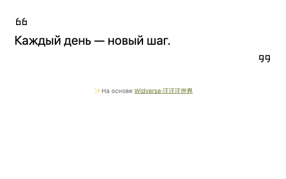

社区源码 · 可用 · 建议 480 × 300 px

保留旧版月历日期高亮、周日期定位、倒数日、多事件进度、季度进度、引用、轮播和翻页时钟行为的俄语版本。

[打开组件或素材](https://zhangleiye68-jpg.github.io/buildin-reference-widgets/community/httishere-ru/quote3.html?ru_text=%D0%9A%D0%B0%D0%B6%D0%B4%D1%8B%D0%B9%20%D0%B4%D0%B5%D0%BD%D1%8C%20%E2%80%94%20%D0%BD%D0%BE%D0%B2%D1%8B%D0%B9%20%D1%88%D0%B0%D0%B3.) · [原始来源](https://github.com/httIsHere/notion-widget) · [源码](https://github.com/zhangleiye68-jpg/buildin-reference-widgets/tree/main/docs/community/httishere-ru)

嵌入／素材地址：

```text
https://zhangleiye68-jpg.github.io/buildin-reference-widgets/community/httishere-ru/quote3.html?ru_text=%D0%9A%D0%B0%D0%B6%D0%B4%D1%8B%D0%B9%20%D0%B4%D0%B5%D0%BD%D1%8C%20%E2%80%94%20%D0%BD%D0%BE%D0%B2%D1%8B%D0%B9%20%D1%88%D0%B0%D0%B3.
```

- 能准确满足需求时，优先复用既有template-ru或简洁月历；此条提供其他变体。
- 保留原e、日期、范围、s、year、sw/dd与颜色；ru_name/ru_text只覆盖显示文案，ru_tasks只按顺序替换任务名称。
- 不新增本地保存，不连接Buildin数据库；历史日期保持原值。
- 多事件模式需提供原tasks/created或有效msg；公开别名使用通用演示日期，默认预览不含私参。
- 保留作者来源署名。动态语录feed、作者访客计数、损坏配置和天气并非此条功能。
- 58组原日期/样式算法对照与29组打包配置解码通过；15种实际公开画面已复核，翻页秒针、轮播5秒自动切换与拖动、跨月范围实际验证。
- 俄语引用采用支持西里尔字母的系统字体；窄栏引号独立留白。轮播保留原远图，失效时用纯色背景保证文字可读。

许可：上游Apache-2.0；依赖MIT；图片与字体仅保留远程引用 · [许可与归属](https://github.com/zhangleiye68-jpg/buildin-reference-widgets/blob/main/docs/community/httishere-ru/NOTICE.md)

目录 ID：`httishere-ru-variants`

### 俄语双块本地数字钟 · 俄语

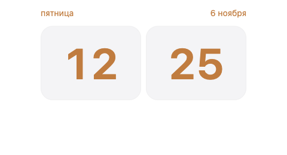

自制 · 可用 · 建议 320 × 260 px

访客本地24小时HH/mm、俄语星期和日期，无秒或AM/PM。

[打开组件或素材](https://zhangleiye68-jpg.github.io/buildin-reference-widgets/cozy-study/?widget=digital-clock&lang=ru&variant=minimal) · [原始来源](https://github.com/zhangleiye68-jpg/buildin-reference-widgets/tree/main/docs/cozy-study) · [源码](https://github.com/zhangleiye68-jpg/buildin-reference-widgets/tree/main/docs/cozy-study)

嵌入／素材地址：

```text
https://zhangleiye68-jpg.github.io/buildin-reference-widgets/cozy-study/?widget=digital-clock&lang=ru&variant=minimal
```

- 读取访客浏览器本地时间，每秒刷新分钟显示；没有秒盘或倒数模式。
- 不读取服务账号、不保存状态、不连接Buildin数据库；不复刻来源服务编辑器。
- 同目录的calendar和clock模式另提供月历与指针钟。

许可：自制，可在本库复用

目录 ID：`local-digital-clock-ru`

## 日历

### 地中海风格月历 · 俄语（来源模板）


自制 · 含示例内容 · 建议 700 × 560 px

地中海风格月历

[打开组件或素材](https://zhangleiye68-jpg.github.io/buildin-reference-widgets/?view=med-calendar&v=26810d7) · [原始来源](https://github.com/zhangleiye68-jpg/buildin-reference-widgets/blob/main/docs/widget.js) · [源码](https://github.com/zhangleiye68-jpg/buildin-reference-widgets/blob/main/docs/widget.js)

嵌入／素材地址：

```text
https://zhangleiye68-jpg.github.io/buildin-reference-widgets/?view=med-calendar&v=26810d7
```

- 独立网页组件，不自动关联 Buildin 原生数据库。
- 默认打开 2026 年 9 月，可手动切月；包含示例事件，不同步 Buildin 日程。

许可：自制，可在本库复用

目录 ID：`widget-010`

### 简洁月历 · 俄语／英语


社区源码 · 可用 · 建议 560 × 420 px

简洁月历

[打开组件或素材](https://zhangleiye68-jpg.github.io/buildin-reference-widgets/community/httishere-calendar/calendar.html?sw=1&dd=0&lang=ru) · [原始来源](https://github.com/httIsHere/notion-widget) · [源码](https://github.com/zhangleiye68-jpg/buildin-reference-widgets/tree/main/docs/community/httishere-calendar/)

嵌入／素材地址：

```text
https://zhangleiye68-jpg.github.io/buildin-reference-widgets/community/httishere-calendar/calendar.html?sw=1&dd=0&lang=ru
```

- 社区源码已收录并保留归属、许可；使用本地简化运行脚本。
- 固定 280px 宽，当前月展示，无切月按钮；sw=1 周日起始，省略则周一起始；dd=1 深色。
- 不支持上游加密配置参数。
- Gitee v3/v4 month 旧地址已返回404；这些别名仅作来源追踪，使用本条目的固定GitHub Pages地址。旧sw参数继续决定周日起始，省略为周一起始。
- 窄栏嵌入可加fit=1，自适应当前宽度（建议至少170px）；默认不加参数时保持原280px布局。
- 可选lang=ru只翻译月份与星期；保留fit、周起始顺序和深色模式。省略语言参数时仍为英语。

许可：Apache-2.0；字体 SIL OFL · [许可与归属](https://github.com/zhangleiye68-jpg/buildin-reference-widgets/blob/main/docs/community/httishere-calendar/NOTICE.md)

目录 ID：`widget-011`

### Cozy 动态月历 · 俄语／英语


自制 · 可用 · 建议 320 × 320 px

跟随当前月份，高亮今天，可切月、选日期和返回今天。

[打开组件或素材](https://zhangleiye68-jpg.github.io/buildin-reference-widgets/cozy-study/?widget=calendar&lang=ru) · [原始来源](https://github.com/zhangleiye68-jpg/buildin-reference-widgets/tree/main/docs/cozy-study/) · [源码](https://github.com/zhangleiye68-jpg/buildin-reference-widgets/tree/main/docs/cozy-study/)

嵌入／素材地址：

```text
https://zhangleiye68-jpg.github.io/buildin-reference-widgets/cozy-study/?widget=calendar&lang=ru
```

- 周一开始；不存储日程，不连接数据库。
- 可加 theme=light 或 theme=dark；无参数时跟随色彩模式。
- 俄语地址：https://zhangleiye68-jpg.github.io/buildin-reference-widgets/cozy-study/?widget=calendar&lang=ru
- 目录默认提供俄语地址与真实预览；去掉 lang=ru 可恢复英语。
- variant=minimal提供简洁源兼容月历：周一、35/42格、非本月淡化、日期不可选择，箭头翻月、标题回今天；无农历。
- 普通Cozy默认保留原42格与选日样式；新变体另支持星期/悬停/今天/箭头/标题/日期数字HEX配色。

许可：MIT · [许可与归属](https://github.com/zhangleiye68-jpg/buildin-reference-widgets/blob/main/docs/cozy-study/LICENSE)

目录 ID：`cozy-calendar`

### WidgetBox 旧月历参考 · 通用


第三方引用 · 已停用参考 · 建议 560 × 420 px

WidgetBox 旧月历参考

[打开组件或素材](https://widgetbox.app/embed/calendar/simple/60788344-032d-4bad-b871-5832168828ae) · [原始来源](https://widgetbox.app/embed/calendar/simple/60788344-032d-4bad-b871-5832168828ae)

嵌入／素材地址：

```text
https://widgetbox.app/embed/calendar/simple/60788344-032d-4bad-b871-5832168828ae
```

- 原模板的旧链接已返回站点推广页，保留作溯源，勿用于新模板。
- 预览若显示站点首页，代表失效状态，不代表原组件效果。

许可：第三方服务，保存引用

目录 ID：`widgetbox-calendar-retired`

## 天气

### 深色天气 · 俄语


自制 · 可用 · 建议 560 × 420 px

默认洛杉矶天气与五日预报，可按坐标和时区切换城市。浅色文字带细黑描边，背景透明。

[打开组件或素材](https://zhangleiye68-jpg.github.io/buildin-reference-widgets/school-planner/weather/?locale=ru&theme=dark&v=30) · [原始来源](https://github.com/zhangleiye68-jpg/buildin-reference-widgets/tree/main/docs/school-planner/weather/) · [源码](https://github.com/zhangleiye68-jpg/buildin-reference-widgets/tree/main/docs/school-planner/weather/)

嵌入／素材地址：

```text
https://zhangleiye68-jpg.github.io/buildin-reference-widgets/school-planner/weather/?locale=ru&theme=dark&v=30
```

- 独立网页组件，不自动关联 Buildin 原生数据库。
- 浅色文字的细黑描边适用于白底和深色背景，组件背景透明。
- 支持 lat/lon/city/tz；forecast_days=7 可选七日。theme=light 可选深色文字，窄栏七日另见 weather-ru-seven-day。
- 默认 PNG 是洛杉矶摄氏五日预报在深色背景上的实际画面。

许可：自制，可在本库复用

目录 ID：`widget-012`

### 俄语城市天气·七日／窄栏 · 俄语

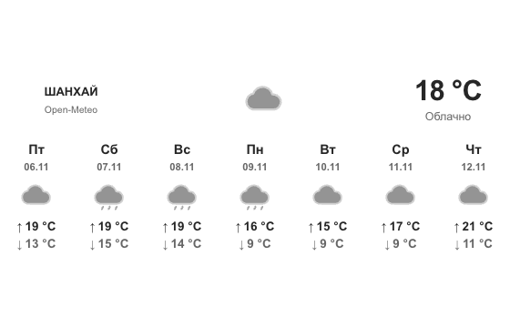

自制 · 可用 · 建议 560 × 360 px

当前温度与七日预报，公开默认使用上海、摄氏和灰度图标。

[打开组件或素材](https://zhangleiye68-jpg.github.io/buildin-reference-widgets/school-planner/weather/?lat=31.230416&lon=121.473701&city=%D0%A8%D0%B0%D0%BD%D1%85%D0%B0%D0%B9&tz=Asia%2FShanghai&forecast_days=7&theme=light&greyscale=1) · [原始来源](https://github.com/zhangleiye68-jpg/buildin-reference-widgets/tree/main/docs/school-planner/weather) · [源码](https://github.com/zhangleiye68-jpg/buildin-reference-widgets/tree/main/docs/school-planner/weather)

嵌入／素材地址：

```text
https://zhangleiye68-jpg.github.io/buildin-reference-widgets/school-planner/weather/?lat=31.230416&lon=121.473701&city=%D0%A8%D0%B0%D0%BD%D1%85%D0%B0%D0%B9&tz=Asia%2FShanghai&forecast_days=7&theme=light&greyscale=1
```

- 数据来自Open-Meteo，不是Indify；相同城市/单位/天数不意味着预报模型、刷新节奏和实时数值相同。
- 十五分钟刷新；一小时内缓存可短暂离线使用，过十五分钟标明数据已过时。无数据时明确显示，不生成温度。
- 默认五日入口保持原样；此条七日模式在≤220px时纵向显示全部七日，最窄77px，需要更高容器或纵向滚动。
- 公开默认是选定城市，不自动读取访客位置；不连接服务账号或原Customize按钮。

许可：自制，可在本库复用

目录 ID：`weather-ru-seven-day`

## 专注与计时

### 总览计时器 · 俄语


自制 · 可用 · 建议 560 × 420 px

总览计时器

[打开组件或素材](https://zhangleiye68-jpg.github.io/buildin-reference-widgets/?view=timer&lang=ru&dashboard=1) · [原始来源](https://github.com/zhangleiye68-jpg/buildin-reference-widgets/blob/main/docs/widget.js) · [源码](https://github.com/zhangleiye68-jpg/buildin-reference-widgets/blob/main/docs/widget.js)

嵌入／素材地址：

```text
https://zhangleiye68-jpg.github.io/buildin-reference-widgets/?view=timer&lang=ru&dashboard=1
```

- 独立网页组件，不自动关联 Buildin 原生数据库。

许可：自制，可在本库复用

目录 ID：`widget-013`

### 番茄钟·25 分钟工作／5 分钟休息 · 英语／通用


第三方引用 · 可用 · 建议 560 × 420 px

番茄钟·25 分钟工作／5 分钟休息

[打开组件或素材](https://widget0.com/e/pomodoro/?work=25&break=5&sound=None&autostart=false&theme=light&accent=37352f) · [原始来源](https://widget0.com/widgets/pomodoro/)

嵌入／素材地址：

```text
https://widget0.com/e/pomodoro/?work=25&break=5&sound=None&autostart=false&theme=light&accent=37352f
```

- 公开服务组件；未确认源码再分发许可，保存地址及参考图。

许可：第三方服务，保存引用

目录 ID：`widget-014`

### 花园专注计时器 · 俄语


自制 · 可用 · 建议 560 × 420 px

花园专注计时器

[打开组件或素材](https://zhangleiye68-jpg.github.io/buildin-reference-widgets/my-life-planner/pomodoro.html) · [原始来源](https://github.com/zhangleiye68-jpg/buildin-reference-widgets/blob/main/docs/my-life-planner/pomodoro.html) · [源码](https://github.com/zhangleiye68-jpg/buildin-reference-widgets/blob/main/docs/my-life-planner/pomodoro.html)

嵌入／素材地址：

```text
https://zhangleiye68-jpg.github.io/buildin-reference-widgets/my-life-planner/pomodoro.html
```

- 独立网页组件，不自动关联 Buildin 原生数据库。

许可：自制，可在本库复用

目录 ID：`widget-015`

### 计时器 · 俄语


自制 · 可用 · 建议 560 × 420 px

计时器

[打开组件或素材](https://zhangleiye68-jpg.github.io/buildin-reference-widgets/?view=timer&lang=ru&v=ee286ab) · [原始来源](https://github.com/zhangleiye68-jpg/buildin-reference-widgets/blob/main/docs/widget.js) · [源码](https://github.com/zhangleiye68-jpg/buildin-reference-widgets/blob/main/docs/widget.js)

嵌入／素材地址：

```text
https://zhangleiye68-jpg.github.io/buildin-reference-widgets/?view=timer&lang=ru&v=ee286ab
```

- 独立网页组件，不自动关联 Buildin 原生数据库。

许可：自制，可在本库复用

目录 ID：`widget-016`

### 计时器 · 英语／通用


自制 · 可用 · 建议 560 × 420 px

计时器

[打开组件或素材](https://zhangleiye68-jpg.github.io/buildin-reference-widgets/?view=timer) · [原始来源](https://github.com/zhangleiye68-jpg/buildin-reference-widgets/blob/main/docs/widget.js) · [源码](https://github.com/zhangleiye68-jpg/buildin-reference-widgets/blob/main/docs/widget.js)

嵌入／素材地址：

```text
https://zhangleiye68-jpg.github.io/buildin-reference-widgets/?view=timer
```

- 独立网页组件，不自动关联 Buildin 原生数据库。

许可：自制，可在本库复用

目录 ID：`widget-017`

### Study With Me 番茄钟 · 英语


第三方引用 · 可用 · 建议 560 × 420 px

Study With Me 番茄钟

[打开组件或素材](https://studywithme.io/aesthetic-pomodoro-timer/) · [原始来源](https://studywithme.io/)

嵌入／素材地址：

```text
https://studywithme.io/aesthetic-pomodoro-timer/
```

- 公开服务，收录原始入口与参考图；实际可嵌入性以目标平台测试为准。

许可：第三方服务，保存引用

目录 ID：`studywithme-pomodoro`

### 模板俄语适配组件（11种模式） · 俄语

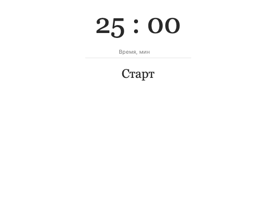

自制 · 可用 · 建议 560 × 420 px

俄语计时器、问候钟、月历、时间进度、日期范围、倒数与星期／节假日组件；保留原模板参数与功能。

[打开组件或素材](https://zhangleiye68-jpg.github.io/buildin-reference-widgets/template-ru/?widget=timer&lang=ru&compact=1) · [原始来源](https://github.com/zhangleiye68-jpg/buildin-reference-widgets/tree/main/docs/template-ru) · [源码](https://github.com/zhangleiye68-jpg/buildin-reference-widgets/tree/main/docs/template-ru)

嵌入／素材地址：

```text
https://zhangleiye68-jpg.github.io/buildin-reference-widgets/template-ru/?widget=timer&lang=ru&compact=1
```

- 计时器Stop重置25:00，并非暂停；每个iframe独立，支持自定义分钟。
- 原e参数只解码为配置JSON，不执行脚本；私人参数不可写进公开目录或预览。
- 保留原日期、配色与月历周起始；ru_name仅替换显示名称。
- 节假日模式固定保留Source2025年中国节假日，不是当年俄罗斯假期。
- 14项功能模型、隔离浏览器11模式默认预览和19个原参数位置验证通过；Buildin页面另行验收。

许可：自制适配代码，可在本库复用；兼容来源与图片引用见说明 · [许可与归属](https://github.com/zhangleiye68-jpg/buildin-reference-widgets/blob/main/docs/template-ru/NOTICE.md)

目录 ID：`template-ru-adapter`

### 俄语专注倒计时（五档预设） · 俄语

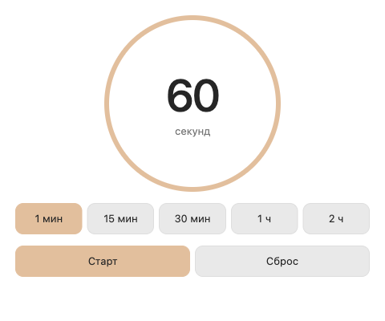

自制 · 可用 · 建议 480 × 400 px

默认60秒，预设1/15/30/60/120分钟，开始、暂停、继续及复位；计时数字也可操作。

[打开组件或素材](https://zhangleiye68-jpg.github.io/buildin-reference-widgets/focus-timer-ru/) · [原始来源](https://github.com/zhangleiye68-jpg/buildin-reference-widgets/tree/main/docs/focus-timer-ru) · [源码](https://github.com/zhangleiye68-jpg/buildin-reference-widgets/tree/main/docs/focus-timer-ru)

嵌入／素材地址：

```text
https://zhangleiye68-jpg.github.io/buildin-reference-widgets/focus-timer-ru/
```

- 独立通用实现，无账号、数据库连接、本地保存、声音或通知。刷新回到默认60秒。
- 选择预设停止并设置时长；复位回当前所选预设。到零停止，可手动再开始。
- 按单调时钟截止时刻计算，后台或bfcache返回后按实际经过时间更新；无法迁移第三方服务状态。
- 161px窄栏到480px所有控件均实际可见，五预设、开始暂停继续复位及bfcache实际验证。

许可：MIT · [许可与归属](https://github.com/zhangleiye68-jpg/buildin-reference-widgets/blob/main/docs/focus-timer-ru/LICENSE)

目录 ID：`focus-timer-ru`

## 进度

### 地中海风格进度 · 俄语（来源模板）


自制 · 可用 · 建议 560 × 420 px

地中海风格进度

[打开组件或素材](https://zhangleiye68-jpg.github.io/buildin-reference-widgets/?view=med-progress&v=9b2067d) · [原始来源](https://github.com/zhangleiye68-jpg/buildin-reference-widgets/blob/main/docs/widget.js) · [源码](https://github.com/zhangleiye68-jpg/buildin-reference-widgets/blob/main/docs/widget.js)

嵌入／素材地址：

```text
https://zhangleiye68-jpg.github.io/buildin-reference-widgets/?view=med-progress&v=9b2067d
```

- 独立网页组件，不自动关联 Buildin 原生数据库。
- 带示例初值，可手动加减；不自动读取数据库完成率。

许可：自制，可在本库复用

目录 ID：`widget-018`

### 总览进度 · 俄语


自制 · 可用 · 建议 560 × 420 px

总览进度

[打开组件或素材](https://zhangleiye68-jpg.github.io/buildin-reference-widgets/?view=progress&dashboard=1&lang=ru&v=ee286ab) · [原始来源](https://github.com/zhangleiye68-jpg/buildin-reference-widgets/blob/main/docs/widget.js) · [源码](https://github.com/zhangleiye68-jpg/buildin-reference-widgets/blob/main/docs/widget.js)

嵌入／素材地址：

```text
https://zhangleiye68-jpg.github.io/buildin-reference-widgets/?view=progress&dashboard=1&lang=ru&v=ee286ab
```

- 独立网页组件，不自动关联 Buildin 原生数据库。

许可：自制，可在本库复用

目录 ID：`widget-019`

### 总览进度 · 英语／通用


自制 · 可用 · 建议 560 × 420 px

总览进度

[打开组件或素材](https://zhangleiye68-jpg.github.io/buildin-reference-widgets/?view=progress&dashboard=1&v=be7dbb4) · [原始来源](https://github.com/zhangleiye68-jpg/buildin-reference-widgets/blob/main/docs/widget.js) · [源码](https://github.com/zhangleiye68-jpg/buildin-reference-widgets/blob/main/docs/widget.js)

嵌入／素材地址：

```text
https://zhangleiye68-jpg.github.io/buildin-reference-widgets/?view=progress&dashboard=1&v=be7dbb4
```

- 独立网页组件，不自动关联 Buildin 原生数据库。

许可：自制，可在本库复用

目录 ID：`widget-020`

### 时间进度 · 俄语


自制 · 可用 · 建议 560 × 320 px

时间进度

[打开组件或素材](https://zhangleiye68-jpg.github.io/buildin-reference-widgets/school-planner/time-progress/?locale=ru&v=31) · [原始来源](https://github.com/zhangleiye68-jpg/buildin-reference-widgets/tree/main/docs/school-planner/time-progress/) · [源码](https://github.com/zhangleiye68-jpg/buildin-reference-widgets/tree/main/docs/school-planner/time-progress/)

嵌入／素材地址：

```text
https://zhangleiye68-jpg.github.io/buildin-reference-widgets/school-planner/time-progress/?locale=ru&v=31
```

- 独立网页组件，不自动关联 Buildin 原生数据库。
- 浅色文字与透明背景，适合深色模板；浅色页面需提供深色底色。

许可：自制，可在本库复用

目录 ID：`widget-021`

### 进度组件 · 俄语


自制 · 可用 · 建议 560 × 420 px

进度组件

[打开组件或素材](https://zhangleiye68-jpg.github.io/buildin-reference-widgets/?view=progress&lang=ru&v=ee286ab) · [原始来源](https://github.com/zhangleiye68-jpg/buildin-reference-widgets/blob/main/docs/widget.js) · [源码](https://github.com/zhangleiye68-jpg/buildin-reference-widgets/blob/main/docs/widget.js)

嵌入／素材地址：

```text
https://zhangleiye68-jpg.github.io/buildin-reference-widgets/?view=progress&lang=ru&v=ee286ab
```

- 独立网页组件，不自动关联 Buildin 原生数据库。

许可：自制，可在本库复用

目录 ID：`widget-022`

### 进度组件 · 英语／通用


自制 · 可用 · 建议 560 × 420 px

进度组件

[打开组件或素材](https://zhangleiye68-jpg.github.io/buildin-reference-widgets/?view=progress) · [原始来源](https://github.com/zhangleiye68-jpg/buildin-reference-widgets/blob/main/docs/widget.js) · [源码](https://github.com/zhangleiye68-jpg/buildin-reference-widgets/blob/main/docs/widget.js)

嵌入／素材地址：

```text
https://zhangleiye68-jpg.github.io/buildin-reference-widgets/?view=progress
```

- 独立网页组件，不自动关联 Buildin 原生数据库。

许可：自制，可在本库复用

目录 ID：`widget-023`

### 可配置时间／人生进度（兼容算法） · 俄语

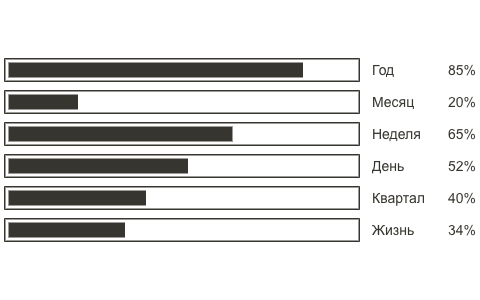

自制 · 含示例内容 · 建议 480 × 300 px

按原整日、分钟、季度和寿命规则计算，可配置显示项与顺序。

[打开组件或素材](https://zhangleiye68-jpg.github.io/buildin-reference-widgets/school-planner/time-progress/legacy.html?bars=year,month,week,day,quarter,life&decimals=0&lifespan=80#birth=2000-01-01) · [原始来源](https://github.com/zhangleiye68-jpg/buildin-reference-widgets/tree/main/docs/school-planner/time-progress) · [源码](https://github.com/zhangleiye68-jpg/buildin-reference-widgets/tree/main/docs/school-planner/time-progress)

嵌入／素材地址：

```text
https://zhangleiye68-jpg.github.io/buildin-reference-widgets/school-planner/time-progress/legacy.html?bars=year,month,week,day,quarter,life&decimals=0&lifespan=80#birth=2000-01-01
```

- 目录预览是通用2000-01-01出生／80年寿命示例，不能当作用户生日或真实账户数据。
- 源兼容算法：周一开始，日/周计分钟，月含今天，年固定除365，季度端点差，人生固定365年基数加trunc寿命/4；标签toFixed舍入。
- 与已有连续时间进度入口不同；生日只从#birth片段读取，不写本地存储，不连接服务账号或Buildin数据库。
- 配置源服务的账号编辑器与Customize入口未复刻。

许可：自制，可在本库复用

目录 ID：`legacy-progress-ru`

## 习惯与阅读计数

### 学习计划阅读计数器 · 俄语


自制 · 可用 · 建议 560 × 420 px

学习计划阅读计数器

[打开组件或素材](https://zhangleiye68-jpg.github.io/buildin-reference-widgets/school-planner/reader.html?view=reader&v=9&locale=ru) · [原始来源](https://github.com/zhangleiye68-jpg/buildin-reference-widgets/blob/main/docs/school-planner/reader.html) · [源码](https://github.com/zhangleiye68-jpg/buildin-reference-widgets/blob/main/docs/school-planner/reader.html)

嵌入／素材地址：

```text
https://zhangleiye68-jpg.github.io/buildin-reference-widgets/school-planner/reader.html?view=reader&v=9&locale=ru
```

- 独立网页组件，不自动关联 Buildin 原生数据库。

许可：自制，可在本库复用

目录 ID：`widget-024`

### 学习计划阅读计数器 · 英语／通用


自制 · 可用 · 建议 560 × 420 px

学习计划阅读计数器

[打开组件或素材](https://zhangleiye68-jpg.github.io/buildin-reference-widgets/school-planner/reader.html?view=reader&v=3) · [原始来源](https://github.com/zhangleiye68-jpg/buildin-reference-widgets/blob/main/docs/school-planner/reader.html) · [源码](https://github.com/zhangleiye68-jpg/buildin-reference-widgets/blob/main/docs/school-planner/reader.html)

嵌入／素材地址：

```text
https://zhangleiye68-jpg.github.io/buildin-reference-widgets/school-planner/reader.html?view=reader&v=3
```

- 独立网页组件，不自动关联 Buildin 原生数据库。

许可：自制，可在本库复用

目录 ID：`widget-025`

### 已读书籍计数器 · 俄语


自制 · 可用 · 建议 560 × 420 px

已读书籍计数器

[打开组件或素材](https://zhangleiye68-jpg.github.io/buildin-reference-widgets/my-life-planner/counter.html) · [原始来源](https://github.com/zhangleiye68-jpg/buildin-reference-widgets/blob/main/docs/my-life-planner/counter.html) · [源码](https://github.com/zhangleiye68-jpg/buildin-reference-widgets/blob/main/docs/my-life-planner/counter.html)

嵌入／素材地址：

```text
https://zhangleiye68-jpg.github.io/buildin-reference-widgets/my-life-planner/counter.html
```

- 独立网页组件，不自动关联 Buildin 原生数据库。

许可：自制，可在本库复用

目录 ID：`widget-026`

### 运动目标计数器 · 俄语


自制 · 可用 · 建议 560 × 180 px

独立目标计数，带加减、进度填充与浏览器本地保存。

[打开组件或素材](https://zhangleiye68-jpg.github.io/buildin-reference-widgets/school-planner/goals/exercise/?locale=ru&v=33) · [原始来源](https://github.com/zhangleiye68-jpg/buildin-reference-widgets/tree/main/docs/school-planner/goals/exercise/) · [源码](https://github.com/zhangleiye68-jpg/buildin-reference-widgets/tree/main/docs/school-planner/goals/exercise/)

嵌入／素材地址：

```text
https://zhangleiye68-jpg.github.io/buildin-reference-widgets/school-planner/goals/exercise/?locale=ru&v=33
```

- 独立网页组件，不自动关联 Buildin 原生数据库。
- 独立本地累计计数，不自动每天清零。

许可：自制，可在本库复用

目录 ID：`widget-027`

### 阅读目标计数器 · 俄语


自制 · 可用 · 建议 560 × 140 px

独立目标计数，带加减、进度填充与浏览器本地保存。

[打开组件或素材](https://zhangleiye68-jpg.github.io/buildin-reference-widgets/school-planner/goals/read/?locale=ru&v=33) · [原始来源](https://github.com/zhangleiye68-jpg/buildin-reference-widgets/tree/main/docs/school-planner/goals/read/) · [源码](https://github.com/zhangleiye68-jpg/buildin-reference-widgets/tree/main/docs/school-planner/goals/read/)

嵌入／素材地址：

```text
https://zhangleiye68-jpg.github.io/buildin-reference-widgets/school-planner/goals/read/?locale=ru&v=33
```

- 独立网页组件，不自动关联 Buildin 原生数据库。
- 独立本地累计计数，不自动每天清零。

许可：自制，可在本库复用

目录 ID：`widget-028`

### 饮水目标计数器 · 俄语


自制 · 可用 · 建议 560 × 180 px

独立目标计数，带加减、进度填充与浏览器本地保存。

[打开组件或素材](https://zhangleiye68-jpg.github.io/buildin-reference-widgets/school-planner/goals/drink/?locale=ru&v=33) · [原始来源](https://github.com/zhangleiye68-jpg/buildin-reference-widgets/tree/main/docs/school-planner/goals/drink/) · [源码](https://github.com/zhangleiye68-jpg/buildin-reference-widgets/tree/main/docs/school-planner/goals/drink/)

嵌入／素材地址：

```text
https://zhangleiye68-jpg.github.io/buildin-reference-widgets/school-planner/goals/drink/?locale=ru&v=33
```

- 独立网页组件，不自动关联 Buildin 原生数据库。
- 独立本地累计计数，不自动每天清零。

许可：自制，可在本库复用

目录 ID：`widget-029`

## 任务与学习面板

### 交互任务面板 · 俄语


自制 · 可用 · 建议 1000 × 720 px

交互任务面板

[打开组件或素材](https://zhangleiye68-jpg.github.io/task-panel-interaction-demo/?lang=ru&v=f891c3f) · [原始来源](https://github.com/zhangleiye68-jpg/task-panel-interaction-demo) · [源码](https://github.com/zhangleiye68-jpg/task-panel-interaction-demo)

嵌入／素材地址：

```text
https://zhangleiye68-jpg.github.io/task-panel-interaction-demo/?lang=ru&v=f891c3f
```

- 独立网页组件，不自动关联 Buildin 原生数据库。

许可：自制，可在本库复用

目录 ID：`widget-030`

### 交互任务面板 · 英语／通用


自制 · 可用 · 建议 1000 × 720 px

交互任务面板

[打开组件或素材](https://zhangleiye68-jpg.github.io/task-panel-interaction-demo/) · [原始来源](https://github.com/zhangleiye68-jpg/task-panel-interaction-demo) · [源码](https://github.com/zhangleiye68-jpg/task-panel-interaction-demo)

嵌入／素材地址：

```text
https://zhangleiye68-jpg.github.io/task-panel-interaction-demo/
```

- 独立网页组件，不自动关联 Buildin 原生数据库。

许可：自制，可在本库复用

目录 ID：`widget-031`

### 学习计划网页仪表盘 · 英语／通用


自制 · 可用 · 建议 1000 × 720 px

学习计划网页仪表盘

[打开组件或素材](https://zhangleiye68-jpg.github.io/buildin-reference-widgets/school-planner/dashboard.html?view=dashboard&v=6) · [原始来源](https://github.com/zhangleiye68-jpg/buildin-reference-widgets/blob/main/docs/school-planner/dashboard.html) · [源码](https://github.com/zhangleiye68-jpg/buildin-reference-widgets/blob/main/docs/school-planner/dashboard.html)

嵌入／素材地址：

```text
https://zhangleiye68-jpg.github.io/buildin-reference-widgets/school-planner/dashboard.html?view=dashboard&v=6
```

- 独立网页组件，不自动关联 Buildin 原生数据库。

许可：自制，可在本库复用

目录 ID：`widget-032`

### 学习计划顶部横幅 · 英语／通用


自制 · 可用 · 建议 560 × 420 px

学习计划顶部横幅

[打开组件或素材](https://zhangleiye68-jpg.github.io/buildin-reference-widgets/school-planner/banner.html?view=banner&v=3) · [原始来源](https://github.com/zhangleiye68-jpg/buildin-reference-widgets/blob/main/docs/school-planner/banner.html) · [源码](https://github.com/zhangleiye68-jpg/buildin-reference-widgets/blob/main/docs/school-planner/banner.html)

嵌入／素材地址：

```text
https://zhangleiye68-jpg.github.io/buildin-reference-widgets/school-planner/banner.html?view=banner&v=3
```

- 独立网页组件，不自动关联 Buildin 原生数据库。

许可：自制，可在本库复用

目录 ID：`widget-033`

## 音乐与白噪声

### LIFE SPACE 环境音播放器 · 俄语


自制 · 可用 · 建议 560 × 420 px

LIFE SPACE 环境音播放器

[打开组件或素材](https://zhangleiye68-jpg.github.io/buildin-reference-widgets/ambient.html?lang=ru&v=37e91a0) · [原始来源](https://github.com/zhangleiye68-jpg/buildin-reference-widgets/blob/main/docs/ambient.html) · [源码](https://github.com/zhangleiye68-jpg/buildin-reference-widgets/blob/main/docs/ambient.html)

嵌入／素材地址：

```text
https://zhangleiye68-jpg.github.io/buildin-reference-widgets/ambient.html?lang=ru&v=37e91a0
```

- 独立网页组件，不自动关联 Buildin 原生数据库。
- 自制合成氛围音示例；不包含第三方歌曲文件。

许可：自制，可在本库复用

目录 ID：`widget-034`

### LIFE SPACE 环境音播放器 · 英语／通用


自制 · 可用 · 建议 560 × 420 px

LIFE SPACE 环境音播放器

[打开组件或素材](https://zhangleiye68-jpg.github.io/buildin-reference-widgets/ambient.html?v=09a2036) · [原始来源](https://github.com/zhangleiye68-jpg/buildin-reference-widgets/blob/main/docs/ambient.html) · [源码](https://github.com/zhangleiye68-jpg/buildin-reference-widgets/blob/main/docs/ambient.html)

嵌入／素材地址：

```text
https://zhangleiye68-jpg.github.io/buildin-reference-widgets/ambient.html?v=09a2036
```

- 独立网页组件，不自动关联 Buildin 原生数据库。
- 自制合成氛围音示例；不包含第三方歌曲文件。

许可：自制，可在本库复用

目录 ID：`widget-035`

### Spotify 歌单 · Spotify 界面


第三方引用 · 可用 · 建议 560 × 352 px

Spotify 歌单

[打开组件或素材](https://open.spotify.com/embed/playlist/5qVEV9KSQzl6MR9qUqFzNW) · [原始来源](https://open.spotify.com/embed/playlist/5qVEV9KSQzl6MR9qUqFzNW)

嵌入／素材地址：

```text
https://open.spotify.com/embed/playlist/5qVEV9KSQzl6MR9qUqFzNW
```

- 仅收录服务嵌入地址与界面参考，不保存音乐文件或服务实现。

许可：第三方服务，保存引用

目录 ID：`widget-036`

### Spotify 歌单·深色 · Spotify 界面


第三方引用 · 可用 · 建议 560 × 352 px

Spotify 歌单·深色

[打开组件或素材](https://open.spotify.com/embed/playlist/2eLwNSlpcwxXHQNWml6m98?theme=0) · [原始来源](https://open.spotify.com/embed/playlist/2eLwNSlpcwxXHQNWml6m98?theme=0)

嵌入／素材地址：

```text
https://open.spotify.com/embed/playlist/2eLwNSlpcwxXHQNWml6m98?theme=0
```

- 仅收录服务嵌入地址与界面参考，不保存音乐文件或服务实现。

许可：第三方服务，保存引用

目录 ID：`widget-037`

### 地中海风格音乐 · 俄语（来源模板）


自制 · 可用 · 建议 560 × 420 px

地中海风格音乐

[打开组件或素材](https://zhangleiye68-jpg.github.io/buildin-reference-widgets/?view=med-music&v=9b2067d) · [原始来源](https://github.com/zhangleiye68-jpg/buildin-reference-widgets/blob/main/docs/widget.js) · [源码](https://github.com/zhangleiye68-jpg/buildin-reference-widgets/blob/main/docs/widget.js)

嵌入／素材地址：

```text
https://zhangleiye68-jpg.github.io/buildin-reference-widgets/?view=med-music&v=9b2067d
```

- 独立网页组件，不自动关联 Buildin 原生数据库。
- 自制合成氛围音示例；不包含第三方歌曲文件。

许可：自制，可在本库复用

目录 ID：`widget-038`

### 效率音乐播放器 · 俄语


自制 · 可用 · 建议 360 × 480 px

效率音乐播放器

[打开组件或素材](https://zhangleiye68-jpg.github.io/buildin-reference-widgets/my-life-planner/music.html) · [原始来源](https://github.com/zhangleiye68-jpg/buildin-reference-widgets/blob/main/docs/my-life-planner/music.html) · [源码](https://github.com/zhangleiye68-jpg/buildin-reference-widgets/blob/main/docs/my-life-planner/music.html)

嵌入／素材地址：

```text
https://zhangleiye68-jpg.github.io/buildin-reference-widgets/my-life-planner/music.html
```

- 独立网页组件，不自动关联 Buildin 原生数据库。
- 自制合成氛围音示例；不包含第三方歌曲文件。

许可：自制，可在本库复用

目录 ID：`widget-039`

### Spotify 学习歌单 A · Spotify 界面


第三方引用 · 可用 · 建议 560 × 352 px

Spotify 学习歌单 A

[打开组件或素材](https://open.spotify.com/embed/playlist/0ofsIXBCxkqYtt30YoJm1c) · [原始来源](https://open.spotify.com/embed/playlist/0ofsIXBCxkqYtt30YoJm1c)

嵌入／素材地址：

```text
https://open.spotify.com/embed/playlist/0ofsIXBCxkqYtt30YoJm1c
```

- 仅保存服务嵌入与预览；播放内容由 Spotify 提供。

许可：第三方服务，保存引用

目录 ID：`spotify-playlist-0ofs`

### Spotify 学习歌单 B · Spotify 界面


第三方引用 · 可用 · 建议 560 × 352 px

Spotify 学习歌单 B

[打开组件或素材](https://open.spotify.com/embed/playlist/6HuGmDDzcvvcJ88nWrPEoG) · [原始来源](https://open.spotify.com/embed/playlist/6HuGmDDzcvvcJ88nWrPEoG)

嵌入／素材地址：

```text
https://open.spotify.com/embed/playlist/6HuGmDDzcvvcJ88nWrPEoG
```

- 仅保存服务嵌入与预览；播放内容由 Spotify 提供。

许可：第三方服务，保存引用

目录 ID：`spotify-playlist-6hug`

## 植物与动物

### 动物·温馨房间 · 俄语


自制 · 可用 · 建议 360 × 480 px

动物·温馨房间

[打开组件或素材](https://zhangleiye68-jpg.github.io/buildin-reference-widgets/my-life-planner/animal.html) · [原始来源](https://github.com/zhangleiye68-jpg/buildin-reference-widgets/blob/main/docs/my-life-planner/animal.html) · [源码](https://github.com/zhangleiye68-jpg/buildin-reference-widgets/blob/main/docs/my-life-planner/animal.html)

嵌入／素材地址：

```text
https://zhangleiye68-jpg.github.io/buildin-reference-widgets/my-life-planner/animal.html
```

- 独立网页组件，不自动关联 Buildin 原生数据库。

许可：自制，可在本库复用

目录 ID：`widget-040`

### 我的植物 · 俄语


自制 · 可用 · 建议 560 × 420 px

我的植物

[打开组件或素材](https://zhangleiye68-jpg.github.io/buildin-reference-widgets/my-life-planner/plant.html) · [原始来源](https://github.com/zhangleiye68-jpg/buildin-reference-widgets/blob/main/docs/my-life-planner/plant.html) · [源码](https://github.com/zhangleiye68-jpg/buildin-reference-widgets/blob/main/docs/my-life-planner/plant.html)

嵌入／素材地址：

```text
https://zhangleiye68-jpg.github.io/buildin-reference-widgets/my-life-planner/plant.html
```

- 独立网页组件，不自动关联 Buildin 原生数据库。

许可：自制，可在本库复用

目录 ID：`widget-041`

## 封面与装饰

### 花园动态封面 · 俄语


自制 · 可用 · 建议 900 × 420 px

自制花园动态网页封面，可作为独立嵌入组件。

[打开组件或素材](https://zhangleiye68-jpg.github.io/buildin-reference-widgets/my-life-planner/cover.html) · [原始来源](https://github.com/zhangleiye68-jpg/buildin-reference-widgets/blob/main/docs/my-life-planner/cover.html) · [源码](https://github.com/zhangleiye68-jpg/buildin-reference-widgets/blob/main/docs/my-life-planner/cover.html)

嵌入／素材地址：

```text
https://zhangleiye68-jpg.github.io/buildin-reference-widgets/my-life-planner/cover.html
```

- 独立网页组件，不自动关联 Buildin 原生数据库。

许可：自制，可在本库复用

目录 ID：`my-life-garden-cover`

### 地中海柠檬分隔条 · 通用


自制 · 可用 · 建议 560 × 420 px

地中海柠檬分隔条

[打开组件或素材](https://zhangleiye68-jpg.github.io/buildin-reference-widgets/assets/mediterranean/v3/azulejo-lemon-divider-v2.svg?v=99aba43) · [原始来源](https://github.com/zhangleiye68-jpg/buildin-reference-widgets/blob/main/docs/assets/mediterranean/v3/azulejo-lemon-divider-v2.svg) · [源码](https://github.com/zhangleiye68-jpg/buildin-reference-widgets/blob/main/docs/assets/mediterranean/v3/azulejo-lemon-divider-v2.svg)

嵌入／素材地址：

```text
https://zhangleiye68-jpg.github.io/buildin-reference-widgets/assets/mediterranean/v3/azulejo-lemon-divider-v2.svg?v=99aba43
```

- 图片或动图素材，作为图片/原生页面封面使用；不含交互控件。

许可：自制，可在本库复用

目录 ID：`asset-001`

### 日历栏目横幅 · 通用


自制 · 可用 · 建议 560 × 420 px

日历栏目横幅

[打开组件或素材](https://zhangleiye68-jpg.github.io/buildin-reference-widgets/assets/mediterranean/v3/banner-calendar-v3.png?v=9b2067d) · [原始来源](https://github.com/zhangleiye68-jpg/buildin-reference-widgets/blob/main/docs/assets/mediterranean/v3/banner-calendar-v3.png) · [源码](https://github.com/zhangleiye68-jpg/buildin-reference-widgets/blob/main/docs/assets/mediterranean/v3/banner-calendar-v3.png)

嵌入／素材地址：

```text
https://zhangleiye68-jpg.github.io/buildin-reference-widgets/assets/mediterranean/v3/banner-calendar-v3.png?v=9b2067d
```

- 图片或动图素材，作为图片/原生页面封面使用；不含交互控件。

许可：自制，可在本库复用

目录 ID：`asset-002`

### 项目栏目横幅 · 通用


自制 · 可用 · 建议 560 × 420 px

项目栏目横幅

[打开组件或素材](https://zhangleiye68-jpg.github.io/buildin-reference-widgets/assets/mediterranean/v3/banner-projects-v3.png?v=9b2067d) · [原始来源](https://github.com/zhangleiye68-jpg/buildin-reference-widgets/blob/main/docs/assets/mediterranean/v3/banner-projects-v3.png) · [源码](https://github.com/zhangleiye68-jpg/buildin-reference-widgets/blob/main/docs/assets/mediterranean/v3/banner-projects-v3.png)

嵌入／素材地址：

```text
https://zhangleiye68-jpg.github.io/buildin-reference-widgets/assets/mediterranean/v3/banner-projects-v3.png?v=9b2067d
```

- 图片或动图素材，作为图片/原生页面封面使用；不含交互控件。

许可：自制，可在本库复用

目录 ID：`asset-003`

### 课表栏目横幅 · 通用


自制 · 可用 · 建议 560 × 420 px

课表栏目横幅

[打开组件或素材](https://zhangleiye68-jpg.github.io/buildin-reference-widgets/assets/mediterranean/v3/banner-schedule-v3.png?v=9b2067d) · [原始来源](https://github.com/zhangleiye68-jpg/buildin-reference-widgets/blob/main/docs/assets/mediterranean/v3/banner-schedule-v3.png) · [源码](https://github.com/zhangleiye68-jpg/buildin-reference-widgets/blob/main/docs/assets/mediterranean/v3/banner-schedule-v3.png)

嵌入／素材地址：

```text
https://zhangleiye68-jpg.github.io/buildin-reference-widgets/assets/mediterranean/v3/banner-schedule-v3.png?v=9b2067d
```

- 图片或动图素材，作为图片/原生页面封面使用；不含交互控件。

许可：自制，可在本库复用

目录 ID：`asset-004`

### 任务栏目横幅 · 通用


自制 · 可用 · 建议 560 × 420 px

任务栏目横幅

[打开组件或素材](https://zhangleiye68-jpg.github.io/buildin-reference-widgets/assets/mediterranean/v3/banner-tasks-v3.png?v=9b2067d) · [原始来源](https://github.com/zhangleiye68-jpg/buildin-reference-widgets/blob/main/docs/assets/mediterranean/v3/banner-tasks-v3.png) · [源码](https://github.com/zhangleiye68-jpg/buildin-reference-widgets/blob/main/docs/assets/mediterranean/v3/banner-tasks-v3.png)

嵌入／素材地址：

```text
https://zhangleiye68-jpg.github.io/buildin-reference-widgets/assets/mediterranean/v3/banner-tasks-v3.png?v=9b2067d
```

- 图片或动图素材，作为图片/原生页面封面使用；不含交互控件。

许可：自制，可在本库复用

目录 ID：`asset-005`

### 地中海激励装饰图 · 通用


自制 · 可用 · 建议 560 × 420 px

地中海激励装饰图

[打开组件或素材](https://zhangleiye68-jpg.github.io/buildin-reference-widgets/assets/mediterranean/v3/motivation-hd.png?v=9b2067d) · [原始来源](https://github.com/zhangleiye68-jpg/buildin-reference-widgets/blob/main/docs/assets/mediterranean/v3/motivation-hd.png) · [源码](https://github.com/zhangleiye68-jpg/buildin-reference-widgets/blob/main/docs/assets/mediterranean/v3/motivation-hd.png)

嵌入／素材地址：

```text
https://zhangleiye68-jpg.github.io/buildin-reference-widgets/assets/mediterranean/v3/motivation-hd.png?v=9b2067d
```

- 图片或动图素材，作为图片/原生页面封面使用；不含交互控件。

许可：自制，可在本库复用

目录 ID：`asset-006`

### 地中海明信片 · 通用


自制 · 可用 · 建议 560 × 420 px

地中海明信片

[打开组件或素材](https://zhangleiye68-jpg.github.io/buildin-reference-widgets/assets/mediterranean/v3/postcard-hd.png?v=9b2067d) · [原始来源](https://github.com/zhangleiye68-jpg/buildin-reference-widgets/blob/main/docs/assets/mediterranean/v3/postcard-hd.png) · [源码](https://github.com/zhangleiye68-jpg/buildin-reference-widgets/blob/main/docs/assets/mediterranean/v3/postcard-hd.png)

嵌入／素材地址：

```text
https://zhangleiye68-jpg.github.io/buildin-reference-widgets/assets/mediterranean/v3/postcard-hd.png?v=9b2067d
```

- 图片或动图素材，作为图片/原生页面封面使用；不含交互控件。

许可：自制，可在本库复用

目录 ID：`asset-007`

### 地中海个人资料图 · 通用


自制 · 可用 · 建议 560 × 420 px

地中海个人资料图

[打开组件或素材](https://zhangleiye68-jpg.github.io/buildin-reference-widgets/assets/mediterranean/v3/profile-final.png?v=9b2067d) · [原始来源](https://github.com/zhangleiye68-jpg/buildin-reference-widgets/blob/main/docs/assets/mediterranean/v3/profile-final.png) · [源码](https://github.com/zhangleiye68-jpg/buildin-reference-widgets/blob/main/docs/assets/mediterranean/v3/profile-final.png)

嵌入／素材地址：

```text
https://zhangleiye68-jpg.github.io/buildin-reference-widgets/assets/mediterranean/v3/profile-final.png?v=9b2067d
```

- 图片或动图素材，作为图片/原生页面封面使用；不含交互控件。

许可：自制，可在本库复用

目录 ID：`asset-008`

### 透明封面占位素材 · 通用


自制 · 内部占位 · 建议 560 × 420 px

透明封面占位素材

[打开组件或素材](https://zhangleiye68-jpg.github.io/buildin-reference-widgets/school-planner/transparent-cover-placeholder.svg) · [原始来源](https://github.com/zhangleiye68-jpg/buildin-reference-widgets/blob/main/docs/school-planner/transparent-cover-placeholder.svg) · [源码](https://github.com/zhangleiye68-jpg/buildin-reference-widgets/blob/main/docs/school-planner/transparent-cover-placeholder.svg)

嵌入／素材地址：

```text
https://zhangleiye68-jpg.github.io/buildin-reference-widgets/school-planner/transparent-cover-placeholder.svg
```

- 内部透明占位素材，不作为可见装饰图推荐。

许可：自制，可在本库复用

目录 ID：`asset-011`

## 动态封面与视频

### 花园动态封面 GIF · 通用


自制 · 可用 · 建议 1920 × 640 px

原 My Life Planner 花园场景 GIF，适合宽幅页面封面。

[打开组件或素材](https://zhangleiye68-jpg.github.io/buildin-reference-widgets/my-life-planner/assets/garden-cover-animated.gif) · [原始来源](https://github.com/zhangleiye68-jpg/buildin-reference-widgets/blob/main/docs/my-life-planner/assets/garden-cover-animated.gif) · [源码](https://github.com/zhangleiye68-jpg/buildin-reference-widgets/blob/main/docs/my-life-planner/assets/garden-cover-animated.gif)

嵌入／素材地址：

```text
https://zhangleiye68-jpg.github.io/buildin-reference-widgets/my-life-planner/assets/garden-cover-animated.gif
```

- 真实文件：1920 × 640 px，约 6.01 秒，48 帧。
- 已核对线上文件与仓库文件一致，并解码确认多帧画面有变化。
- GIF 保留原有动画；可作为图片或原生页面封面使用。
- 文件设置为无限循环。

许可：自制，可在本库复用

目录 ID：`asset-009`

### 池塘动态封面 GIF · 通用


自制 · 可用 · 建议 960 × 540 px

原 School Planner 池塘场景的循环 GIF，适合装饰卡片和页面封面。

[打开组件或素材](https://zhangleiye68-jpg.github.io/buildin-reference-widgets/school-planner/pond-cover.gif) · [原始来源](https://github.com/zhangleiye68-jpg/buildin-reference-widgets/blob/main/docs/school-planner/pond-cover.gif) · [源码](https://github.com/zhangleiye68-jpg/buildin-reference-widgets/blob/main/docs/school-planner/pond-cover.gif)

嵌入／素材地址：

```text
https://zhangleiye68-jpg.github.io/buildin-reference-widgets/school-planner/pond-cover.gif
```

- 真实文件：960 × 540 px，约 6 秒，60 帧。
- 已核对线上文件与仓库文件一致，并解码确认多帧画面有变化。
- GIF 保留原有动画；可作为图片或原生页面封面使用。
- 文件设置为无限循环。

许可：自制，可在本库复用

目录 ID：`asset-010`

### 像素植物动态横幅 GIF · 通用


自制 · 可用 · 建议 1280 × 184 px

原 School Planner 中的像素植物循环横幅，适合窄横幅或原生页面封面。

[打开组件或素材](https://zhangleiye68-jpg.github.io/buildin-reference-widgets/school-planner/study-cover.gif) · [原始来源](https://github.com/zhangleiye68-jpg/buildin-reference-widgets/blob/main/docs/school-planner/study-cover.gif) · [源码](https://github.com/zhangleiye68-jpg/buildin-reference-widgets/blob/main/docs/school-planner/study-cover.gif)

嵌入／素材地址：

```text
https://zhangleiye68-jpg.github.io/buildin-reference-widgets/school-planner/study-cover.gif
```

- 真实文件：1280 × 184 px，约 8.08 秒，97 帧。
- 已核对线上文件与仓库文件一致，并解码确认多帧画面有变化。
- GIF 保留原有动画；可作为图片或原生页面封面使用。
- 文件设置为无限循环。
- 目录缩略图为静帧；打开素材链接可查看实际动画。
- 已与此前顶部封面生成记录和原始输出逐字节核对，确认属于自制素材。

许可：此前自制模板的生成素材，可在本库复用

目录 ID：`school-study-cover-gif`

### 池塘循环视频 MP4 · 通用


自制 · 可用 · 建议 1280 × 720 px

原 School Planner 池塘视频文件，与池塘 GIF 对应；保留原文件及音轨。

[打开组件或素材](https://zhangleiye68-jpg.github.io/buildin-reference-widgets/school-planner/pond-loop.mp4) · [原始来源](https://github.com/zhangleiye68-jpg/buildin-reference-widgets/blob/main/docs/school-planner/pond-loop.mp4) · [源码](https://github.com/zhangleiye68-jpg/buildin-reference-widgets/blob/main/docs/school-planner/pond-loop.mp4)

嵌入／素材地址：

```text
https://zhangleiye68-jpg.github.io/buildin-reference-widgets/school-planner/pond-loop.mp4
```

- 真实文件：1280 × 720 px，约 6.08 秒，145 帧。
- 已核对线上文件与仓库文件一致，并解码确认多帧画面有变化。
- MP4 播放与循环由嵌入播放器控制；作为原生图片封面时请选择对应 GIF。
- 文件包含音轨，静音播放需由播放器设置。

许可：自制，可在本库复用

目录 ID：`school-pond-loop-mp4`

### 花园动态封面 MP4 · 通用


自制 · 可用 · 建议 1920 × 640 px

原 My Life Planner 花园场景视频，与花园 GIF 对应。

[打开组件或素材](https://zhangleiye68-jpg.github.io/buildin-reference-widgets/my-life-planner/assets/garden-cover-preview.mp4) · [原始来源](https://github.com/zhangleiye68-jpg/buildin-reference-widgets/blob/main/docs/my-life-planner/assets/garden-cover-preview.mp4) · [源码](https://github.com/zhangleiye68-jpg/buildin-reference-widgets/blob/main/docs/my-life-planner/assets/garden-cover-preview.mp4)

嵌入／素材地址：

```text
https://zhangleiye68-jpg.github.io/buildin-reference-widgets/my-life-planner/assets/garden-cover-preview.mp4
```

- 真实文件：1920 × 640 px，约 6 秒，60 帧。
- 已核对线上文件与仓库文件一致，并解码确认多帧画面有变化。
- MP4 播放与循环由嵌入播放器控制；作为原生图片封面时请选择对应 GIF。
- 文件没有音轨。

许可：自制，可在本库复用

目录 ID：`garden-cover-preview-mp4`

### 地中海动态封面 GIF（历史版） · 通用


自制 · 可用 · 建议 1200 × 400 px

地中海模板已有的首版动态封面；保留旧地址供历史模板继续使用。

[打开组件或素材](https://zhangleiye68-jpg.github.io/buildin-reference-widgets/assets/mediterranean/v4/cover-dynamic-loop-v1.gif) · [原始来源](https://github.com/zhangleiye68-jpg/buildin-reference-widgets/blob/main/docs/assets/mediterranean/v4/cover-dynamic-loop-v1.gif) · [源码](https://github.com/zhangleiye68-jpg/buildin-reference-widgets/blob/main/docs/assets/mediterranean/v4/cover-dynamic-loop-v1.gif)

嵌入／素材地址：

```text
https://zhangleiye68-jpg.github.io/buildin-reference-widgets/assets/mediterranean/v4/cover-dynamic-loop-v1.gif
```

- 真实文件：1200 × 400 px，约 6 秒，60 帧。
- 已核对线上文件与仓库文件一致，并解码确认多帧画面有变化。
- GIF 保留原有动画；可作为图片或原生页面封面使用。
- 文件设置为无限循环。
- 目录缩略图为静帧；打开素材链接可查看实际动画。
- 这是历史版本；新模板优先使用“地中海固定机位动态封面 GIF”。

许可：自制，可在本库复用

目录 ID：`mediterranean-cover-loop-v1-gif`

### 地中海固定机位动态封面 GIF · 通用


自制 · 可用 · 建议 1920 × 640 px

地中海模板固定机位高清动态封面，适合宽幅原生页面封面。

[打开组件或素材](https://zhangleiye68-jpg.github.io/buildin-reference-widgets/assets/mediterranean/v5/cover-fixed-camera-hd.gif) · [原始来源](https://github.com/zhangleiye68-jpg/buildin-reference-widgets/blob/main/docs/assets/mediterranean/v5/cover-fixed-camera-hd.gif) · [源码](https://github.com/zhangleiye68-jpg/buildin-reference-widgets/blob/main/docs/assets/mediterranean/v5/cover-fixed-camera-hd.gif)

嵌入／素材地址：

```text
https://zhangleiye68-jpg.github.io/buildin-reference-widgets/assets/mediterranean/v5/cover-fixed-camera-hd.gif
```

- 真实文件：1920 × 640 px，约 6 秒，120 帧。
- 已核对线上文件与仓库文件一致，并解码确认多帧画面有变化。
- GIF 保留原有动画；可作为图片或原生页面封面使用。
- 文件设置为无限循环。
- 目录缩略图为静帧；打开素材链接可查看实际动画。

许可：自制，可在本库复用

目录 ID：`mediterranean-cover-fixed-camera-gif`

### 像素窗边植物动图 · 通用


自制 · 可用 · 建议 480 × 600 px

像素学生计划的动态装饰素材。

[打开组件或素材](https://zhangleiye68-jpg.github.io/buildin-reference-widgets/assets/animations/school-planner/window.gif) · [原始来源](https://github.com/zhangleiye68-jpg/buildin-reference-widgets/blob/main/docs/assets/animations/school-planner/window.gif) · [源码](https://github.com/zhangleiye68-jpg/buildin-reference-widgets/blob/main/docs/assets/animations/school-planner/window.gif)

嵌入／素材地址：

```text
https://zhangleiye68-jpg.github.io/buildin-reference-widgets/assets/animations/school-planner/window.gif
```

- 480 × 600 px，约 8.08 秒，97 帧。
- 目录为静帧预览；打开素材地址可查看完整动态效果。
- 可作为图片、装饰块或原生页面封面使用；按原始比例放置。
- GIF 已设为无限循环。

许可：此前自制模板生成／制作素材，可在本库模板中复用；未声明通用开源许可

目录 ID：`school-planner-window-gif`

### 原像素植物封面 GIF（第三方引用） · 通用


第三方引用 · 待复核 · 建议 700 × 434 px

原学生计划模板的动态装饰素材。

[打开组件或素材](https://64.media.tumblr.com/ce237ad7762fc6bce812f5f47f499d76/215844a9b980cfd1-b8/s1280x1920/7acfce390ffb6e00a0b8f0dce34b0c0169943001.gif) · [原始来源](https://64.media.tumblr.com/ce237ad7762fc6bce812f5f47f499d76/215844a9b980cfd1-b8/s1280x1920/7acfce390ffb6e00a0b8f0dce34b0c0169943001.gif)

嵌入／素材地址：

```text
https://64.media.tumblr.com/ce237ad7762fc6bce812f5f47f499d76/215844a9b980cfd1-b8/s1280x1920/7acfce390ffb6e00a0b8f0dce34b0c0169943001.gif
```

- 700 × 434 px，约 6.64 秒，83 帧。
- 目录为静帧预览；打开素材地址可查看完整动态效果。
- 只收录公开来源链接、说明及静帧参考图；未镜像原 GIF 文件，也未声明开源或自制。
- GIF 已设为无限循环。

许可：第三方公开素材，仅引用；再分发许可未确认

目录 ID：`school-original-pixel-cover-reference`

### Inner Garden 额心光环动图 · 通用


自制 · 可用 · 建议 720 × 240 px

My Inner Garden的动态装饰素材。

[打开组件或素材](https://zhangleiye68-jpg.github.io/buildin-reference-widgets/assets/animations/inner-garden/halo.gif) · [原始来源](https://github.com/zhangleiye68-jpg/buildin-reference-widgets/blob/main/docs/assets/animations/inner-garden/halo.gif) · [源码](https://github.com/zhangleiye68-jpg/buildin-reference-widgets/blob/main/docs/assets/animations/inner-garden/halo.gif)

嵌入／素材地址：

```text
https://zhangleiye68-jpg.github.io/buildin-reference-widgets/assets/animations/inner-garden/halo.gif
```

- 720 × 240 px，约 5.07 秒，71 帧。
- 目录为静帧预览；打开素材地址可查看完整动态效果。
- 可作为图片、装饰块或原生页面封面使用；按原始比例放置。
- GIF 已设为无限循环。

许可：此前自制模板生成／制作素材，可在本库模板中复用；未声明通用开源许可

目录 ID：`inner-garden-halo-gif`

### Inner Garden 白马与女孩动图 · 通用


自制 · 可用 · 建议 720 × 240 px

My Inner Garden的动态装饰素材。

[打开组件或素材](https://zhangleiye68-jpg.github.io/buildin-reference-widgets/assets/animations/inner-garden/horse.gif) · [原始来源](https://github.com/zhangleiye68-jpg/buildin-reference-widgets/blob/main/docs/assets/animations/inner-garden/horse.gif) · [源码](https://github.com/zhangleiye68-jpg/buildin-reference-widgets/blob/main/docs/assets/animations/inner-garden/horse.gif)

嵌入／素材地址：

```text
https://zhangleiye68-jpg.github.io/buildin-reference-widgets/assets/animations/inner-garden/horse.gif
```

- 720 × 240 px，约 5.07 秒，71 帧。
- 目录为静帧预览；打开素材地址可查看完整动态效果。
- 可作为图片、装饰块或原生页面封面使用；按原始比例放置。
- GIF 已设为无限循环。

许可：此前自制模板生成／制作素材，可在本库模板中复用；未声明通用开源许可

目录 ID：`inner-garden-horse-gif`

### Inner Garden 溪边冥想动图 · 通用


自制 · 可用 · 建议 720 × 240 px

My Inner Garden的动态装饰素材。

[打开组件或素材](https://zhangleiye68-jpg.github.io/buildin-reference-widgets/assets/animations/inner-garden/meditation.gif) · [原始来源](https://github.com/zhangleiye68-jpg/buildin-reference-widgets/blob/main/docs/assets/animations/inner-garden/meditation.gif) · [源码](https://github.com/zhangleiye68-jpg/buildin-reference-widgets/blob/main/docs/assets/animations/inner-garden/meditation.gif)

嵌入／素材地址：

```text
https://zhangleiye68-jpg.github.io/buildin-reference-widgets/assets/animations/inner-garden/meditation.gif
```

- 720 × 240 px，约 5.07 秒，71 帧。
- 目录为静帧预览；打开素材地址可查看完整动态效果。
- 可作为图片、装饰块或原生页面封面使用；按原始比例放置。
- GIF 已设为无限循环。

许可：此前自制模板生成／制作素材，可在本库模板中复用；未声明通用开源许可

目录 ID：`inner-garden-meditation-gif`

### Inner Garden 字符飞蛾动图 · 通用

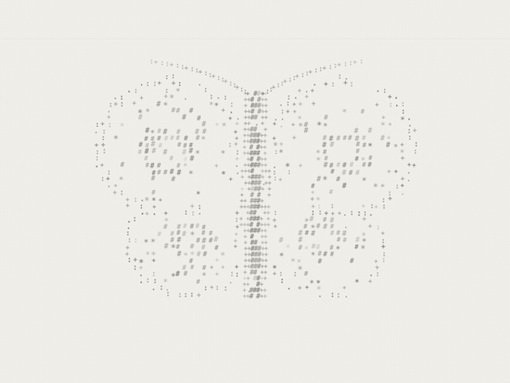

自制 · 可用 · 建议 600 × 450 px

My Inner Garden的动态装饰素材。

[打开组件或素材](https://zhangleiye68-jpg.github.io/buildin-reference-widgets/assets/animations/inner-garden/moth.gif) · [原始来源](https://github.com/zhangleiye68-jpg/buildin-reference-widgets/blob/main/docs/assets/animations/inner-garden/moth.gif) · [源码](https://github.com/zhangleiye68-jpg/buildin-reference-widgets/blob/main/docs/assets/animations/inner-garden/moth.gif)

嵌入／素材地址：

```text
https://zhangleiye68-jpg.github.io/buildin-reference-widgets/assets/animations/inner-garden/moth.gif
```

- 600 × 450 px，约 5 秒，70 帧。
- 目录为静帧预览；打开素材地址可查看完整动态效果。
- 可作为图片、装饰块或原生页面封面使用；按原始比例放置。
- GIF 已设为无限循环。

许可：此前自制模板生成／制作素材，可在本库模板中复用；未声明通用开源许可

目录 ID：`inner-garden-moth-gif`

### 数字花园粉色花朵动图 · 通用


自制 · 可用 · 建议 360 × 405 px

数字花园的动态装饰素材。

[打开组件或素材](https://zhangleiye68-jpg.github.io/buildin-reference-widgets/assets/animations/digital-garden/kollab-flower-loop.gif) · [原始来源](https://github.com/zhangleiye68-jpg/buildin-reference-widgets/blob/main/docs/assets/animations/digital-garden/kollab-flower-loop.gif) · [源码](https://github.com/zhangleiye68-jpg/buildin-reference-widgets/blob/main/docs/assets/animations/digital-garden/kollab-flower-loop.gif)

嵌入／素材地址：

```text
https://zhangleiye68-jpg.github.io/buildin-reference-widgets/assets/animations/digital-garden/kollab-flower-loop.gif
```

- 360 × 405 px，约 4 秒，48 帧。
- 目录为静帧预览；打开素材地址可查看完整动态效果。
- 可作为图片、装饰块或原生页面封面使用；按原始比例放置。
- GIF 已设为无限循环。

许可：此前自制模板生成／制作素材，可在本库模板中复用；未声明通用开源许可

目录 ID：`digital-garden-kollab-flower-loop-gif`

### 数字花园页头动图 · 通用


自制 · 可用 · 建议 960 × 176 px

数字花园的动态装饰素材。

[打开组件或素材](https://zhangleiye68-jpg.github.io/buildin-reference-widgets/assets/animations/digital-garden/page-cover-final.gif) · [原始来源](https://github.com/zhangleiye68-jpg/buildin-reference-widgets/blob/main/docs/assets/animations/digital-garden/page-cover-final.gif) · [源码](https://github.com/zhangleiye68-jpg/buildin-reference-widgets/blob/main/docs/assets/animations/digital-garden/page-cover-final.gif)

嵌入／素材地址：

```text
https://zhangleiye68-jpg.github.io/buildin-reference-widgets/assets/animations/digital-garden/page-cover-final.gif
```

- 960 × 176 px，约 4 秒，40 帧。
- 目录为静帧预览；打开素材地址可查看完整动态效果。
- 可作为图片、装饰块或原生页面封面使用；按原始比例放置。
- GIF 已设为无限循环。

许可：此前自制模板生成／制作素材，可在本库模板中复用；未声明通用开源许可

目录 ID：`digital-garden-page-cover-final-gif`

### 数字花园像素伙伴动图（俄语） · 俄语


自制 · 可用 · 建议 560 × 458 px

数字花园的动态装饰素材。

[打开组件或素材](https://zhangleiye68-jpg.github.io/buildin-reference-widgets/assets/animations/digital-garden/pixel-friends-loop-ru.gif) · [原始来源](https://github.com/zhangleiye68-jpg/buildin-reference-widgets/blob/main/docs/assets/animations/digital-garden/pixel-friends-loop-ru.gif) · [源码](https://github.com/zhangleiye68-jpg/buildin-reference-widgets/blob/main/docs/assets/animations/digital-garden/pixel-friends-loop-ru.gif)

嵌入／素材地址：

```text
https://zhangleiye68-jpg.github.io/buildin-reference-widgets/assets/animations/digital-garden/pixel-friends-loop-ru.gif
```

- 560 × 458 px，约 4.08 秒，49 帧。
- 目录为静帧预览；打开素材地址可查看完整动态效果。
- 可作为图片、装饰块或原生页面封面使用；按原始比例放置。
- GIF 已设为无限循环。

许可：此前自制模板生成／制作素材，可在本库模板中复用；未声明通用开源许可

目录 ID：`digital-garden-pixel-friends-loop-ru-gif`

### 像素森林瀑布动图 · 通用


自制 · 可用 · 建议 480 × 600 px

像素学生计划的动态装饰素材。

[打开组件或素材](https://zhangleiye68-jpg.github.io/buildin-reference-widgets/assets/animations/school-planner/forest-waterfall-v2-optimized.gif) · [原始来源](https://github.com/zhangleiye68-jpg/buildin-reference-widgets/blob/main/docs/assets/animations/school-planner/forest-waterfall-v2-optimized.gif) · [源码](https://github.com/zhangleiye68-jpg/buildin-reference-widgets/blob/main/docs/assets/animations/school-planner/forest-waterfall-v2-optimized.gif)

嵌入／素材地址：

```text
https://zhangleiye68-jpg.github.io/buildin-reference-widgets/assets/animations/school-planner/forest-waterfall-v2-optimized.gif
```

- 480 × 600 px，约 8 秒，80 帧。
- 目录为静帧预览；打开素材地址可查看完整动态效果。
- 可作为图片、装饰块或原生页面封面使用；按原始比例放置。
- GIF 已设为无限循环。

许可：此前自制模板生成／制作素材，可在本库模板中复用；未声明通用开源许可

目录 ID：`school-planner-forest-waterfall-v2-optimized-gif`

### 思维花园卡片动图 · 通用


自制 · 可用 · 建议 720 × 405 px

数字花园的动态装饰素材。

[打开组件或素材](https://zhangleiye68-jpg.github.io/buildin-reference-widgets/assets/animations/digital-garden/mind-garden-card-optimized.gif) · [原始来源](https://github.com/zhangleiye68-jpg/buildin-reference-widgets/blob/main/docs/assets/animations/digital-garden/mind-garden-card-optimized.gif) · [源码](https://github.com/zhangleiye68-jpg/buildin-reference-widgets/blob/main/docs/assets/animations/digital-garden/mind-garden-card-optimized.gif)

嵌入／素材地址：

```text
https://zhangleiye68-jpg.github.io/buildin-reference-widgets/assets/animations/digital-garden/mind-garden-card-optimized.gif
```

- 720 × 405 px，约 4.01 秒，32 帧。
- 目录为静帧预览；打开素材地址可查看完整动态效果。
- 可作为图片、装饰块或原生页面封面使用；按原始比例放置。
- GIF 已设为无限循环。

许可：此前自制模板生成／制作素材，可在本库模板中复用；未声明通用开源许可

目录 ID：`digital-garden-mind-garden-card-optimized-gif`

### Inner Garden 梦境瀑布动图 · 通用


自制 · 可用 · 建议 720 × 540 px

My Inner Garden的动态装饰素材。

[打开组件或素材](https://zhangleiye68-jpg.github.io/buildin-reference-widgets/assets/animations/inner-garden/waterfall.gif) · [原始来源](https://github.com/zhangleiye68-jpg/buildin-reference-widgets/blob/main/docs/assets/animations/inner-garden/waterfall.gif) · [源码](https://github.com/zhangleiye68-jpg/buildin-reference-widgets/blob/main/docs/assets/animations/inner-garden/waterfall.gif)

嵌入／素材地址：

```text
https://zhangleiye68-jpg.github.io/buildin-reference-widgets/assets/animations/inner-garden/waterfall.gif
```

- 720 × 540 px，约 5.07 秒，71 帧。
- 目录为静帧预览；打开素材地址可查看完整动态效果。
- 可作为图片、装饰块或原生页面封面使用；按原始比例放置。
- GIF 已设为无限循环。

许可：此前自制模板生成／制作素材，可在本库模板中复用；未声明通用开源许可

目录 ID：`inner-garden-waterfall-gif`

### 思维花园封面动图 · 通用


自制 · 可用 · 建议 960 × 176 px

数字花园的动态装饰素材。

[打开组件或素材](https://zhangleiye68-jpg.github.io/buildin-reference-widgets/assets/animations/digital-garden/mind-garden-cover-optimized.gif) · [原始来源](https://github.com/zhangleiye68-jpg/buildin-reference-widgets/blob/main/docs/assets/animations/digital-garden/mind-garden-cover-optimized.gif) · [源码](https://github.com/zhangleiye68-jpg/buildin-reference-widgets/blob/main/docs/assets/animations/digital-garden/mind-garden-cover-optimized.gif)

嵌入／素材地址：

```text
https://zhangleiye68-jpg.github.io/buildin-reference-widgets/assets/animations/digital-garden/mind-garden-cover-optimized.gif
```

- 960 × 176 px，约 4.01 秒，32 帧。
- 目录为静帧预览；打开素材地址可查看完整动态效果。
- 可作为图片、装饰块或原生页面封面使用；按原始比例放置。
- GIF 已设为无限循环。

许可：此前自制模板生成／制作素材，可在本库模板中复用；未声明通用开源许可

目录 ID：`digital-garden-mind-garden-cover-optimized-gif`

### 生活计划花园封面 GIF（原生版） · 通用


自制 · 可用 · 建议 960 × 240 px

生活计划的动态装饰素材。

[打开组件或素材](https://zhangleiye68-jpg.github.io/buildin-reference-widgets/assets/animations/my-life-planner/cover-garden-loop.gif) · [原始来源](https://github.com/zhangleiye68-jpg/buildin-reference-widgets/blob/main/docs/assets/animations/my-life-planner/cover-garden-loop.gif) · [源码](https://github.com/zhangleiye68-jpg/buildin-reference-widgets/blob/main/docs/assets/animations/my-life-planner/cover-garden-loop.gif)

嵌入／素材地址：

```text
https://zhangleiye68-jpg.github.io/buildin-reference-widgets/assets/animations/my-life-planner/cover-garden-loop.gif
```

- 960 × 240 px，约 5 秒，60 帧。
- 目录为静帧预览；打开素材地址可查看完整动态效果。
- 可作为图片、装饰块或原生页面封面使用；按原始比例放置。
- GIF 已设为无限循环。

许可：此前自制模板生成／制作素材，可在本库模板中复用；未声明通用开源许可

目录 ID：`my-life-planner-cover-garden-loop-gif`

### 数字花园复古瑜伽动图 · 通用


自制 · 可用 · 建议 720 × 405 px

数字花园的动态装饰素材。

[打开组件或素材](https://zhangleiye68-jpg.github.io/buildin-reference-widgets/assets/animations/digital-garden/kollab-yoga-loop.gif) · [原始来源](https://github.com/zhangleiye68-jpg/buildin-reference-widgets/blob/main/docs/assets/animations/digital-garden/kollab-yoga-loop.gif) · [源码](https://github.com/zhangleiye68-jpg/buildin-reference-widgets/blob/main/docs/assets/animations/digital-garden/kollab-yoga-loop.gif)

嵌入／素材地址：

```text
https://zhangleiye68-jpg.github.io/buildin-reference-widgets/assets/animations/digital-garden/kollab-yoga-loop.gif
```

- 720 × 405 px，约 4 秒，48 帧。
- 目录为静帧预览；打开素材地址可查看完整动态效果。
- 可作为图片、装饰块或原生页面封面使用；按原始比例放置。
- GIF 已设为无限循环。

许可：此前自制模板生成／制作素材，可在本库模板中复用；未声明通用开源许可

目录 ID：`digital-garden-kollab-yoga-loop-gif`

### 秘密花园动图（俄语） · 俄语


自制 · 可用 · 建议 800 × 168 px

数字花园的动态装饰素材。

[打开组件或素材](https://zhangleiye68-jpg.github.io/buildin-reference-widgets/assets/animations/digital-garden/secret-garden-loop-ru.gif) · [原始来源](https://github.com/zhangleiye68-jpg/buildin-reference-widgets/blob/main/docs/assets/animations/digital-garden/secret-garden-loop-ru.gif) · [源码](https://github.com/zhangleiye68-jpg/buildin-reference-widgets/blob/main/docs/assets/animations/digital-garden/secret-garden-loop-ru.gif)

嵌入／素材地址：

```text
https://zhangleiye68-jpg.github.io/buildin-reference-widgets/assets/animations/digital-garden/secret-garden-loop-ru.gif
```

- 800 × 168 px，约 4.08 秒，49 帧。
- 目录为静帧预览；打开素材地址可查看完整动态效果。
- 可作为图片、装饰块或原生页面封面使用；按原始比例放置。
- GIF 已设为无限循环。

许可：此前自制模板生成／制作素材，可在本库模板中复用；未声明通用开源许可

目录 ID：`digital-garden-secret-garden-loop-ru-gif`

### 数字花园花藤分隔动图 · 通用


自制 · 可用 · 建议 800 × 104 px

数字花园的动态装饰素材。

[打开组件或素材](https://zhangleiye68-jpg.github.io/buildin-reference-widgets/assets/animations/digital-garden/kollab-floral-vine-loop-v2.gif) · [原始来源](https://github.com/zhangleiye68-jpg/buildin-reference-widgets/blob/main/docs/assets/animations/digital-garden/kollab-floral-vine-loop-v2.gif) · [源码](https://github.com/zhangleiye68-jpg/buildin-reference-widgets/blob/main/docs/assets/animations/digital-garden/kollab-floral-vine-loop-v2.gif)

嵌入／素材地址：

```text
https://zhangleiye68-jpg.github.io/buildin-reference-widgets/assets/animations/digital-garden/kollab-floral-vine-loop-v2.gif
```

- 800 × 104 px，约 4.08 秒，49 帧。
- 目录为静帧预览；打开素材地址可查看完整动态效果。
- 可作为图片、装饰块或原生页面封面使用；按原始比例放置。
- GIF 已设为无限循环。

许可：此前自制模板生成／制作素材，可在本库模板中复用；未声明通用开源许可

目录 ID：`digital-garden-kollab-floral-vine-loop-v2-gif`

### 番茄钟状态演示 GIF · 英语演示

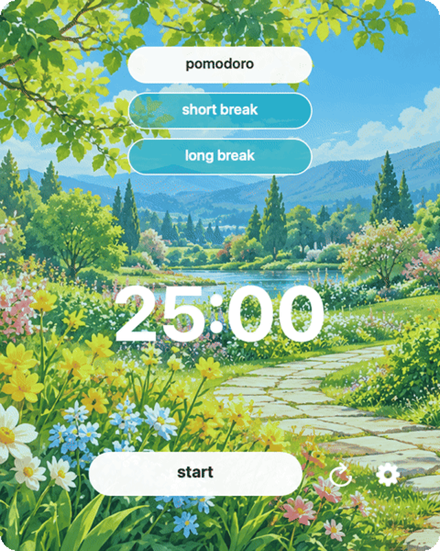

自制 · 可用 · 建议 480 × 600 px

生活计划的组件状态演示。

[打开组件或素材](https://zhangleiye68-jpg.github.io/buildin-reference-widgets/assets/animations/my-life-planner/pomodoro-demo.gif) · [原始来源](https://github.com/zhangleiye68-jpg/buildin-reference-widgets/blob/main/docs/assets/animations/my-life-planner/pomodoro-demo.gif) · [源码](https://github.com/zhangleiye68-jpg/buildin-reference-widgets/blob/main/docs/assets/animations/my-life-planner/pomodoro-demo.gif)

嵌入／素材地址：

```text
https://zhangleiye68-jpg.github.io/buildin-reference-widgets/assets/animations/my-life-planner/pomodoro-demo.gif
```

- 480 × 600 px，约 3 秒，36 帧。
- 目录为静帧预览；打开素材地址可查看完整动态效果。
- 这是此前组件审核包的状态演示图片；需要点击、计时或保存计数时，请使用目录中的对应交互组件。
- 计数和时间均为演示状态，不读取或同步个人数据。
- GIF 已设为无限循环。

许可：此前自制模板生成／制作素材，可在本库模板中复用；未声明通用开源许可

目录 ID：`my-life-planner-pomodoro-demo-gif`

### 翻页时钟状态演示 GIF · 英语演示

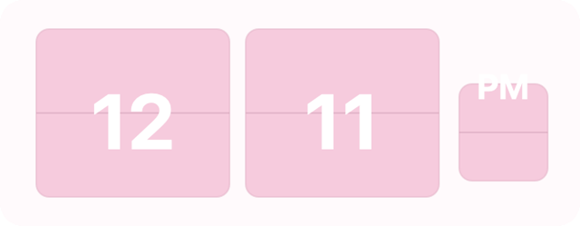

自制 · 可用 · 建议 720 × 280 px

生活计划的组件状态演示。

[打开组件或素材](https://zhangleiye68-jpg.github.io/buildin-reference-widgets/assets/animations/my-life-planner/flip-clock-demo.gif) · [原始来源](https://github.com/zhangleiye68-jpg/buildin-reference-widgets/blob/main/docs/assets/animations/my-life-planner/flip-clock-demo.gif) · [源码](https://github.com/zhangleiye68-jpg/buildin-reference-widgets/blob/main/docs/assets/animations/my-life-planner/flip-clock-demo.gif)

嵌入／素材地址：

```text
https://zhangleiye68-jpg.github.io/buildin-reference-widgets/assets/animations/my-life-planner/flip-clock-demo.gif
```

- 720 × 280 px，约 5 秒，60 帧。
- 目录为静帧预览；打开素材地址可查看完整动态效果。
- 这是此前组件审核包的状态演示图片；需要点击、计时或保存计数时，请使用目录中的对应交互组件。
- 计数和时间均为演示状态，不读取或同步个人数据。
- GIF 已设为无限循环。

许可：此前自制模板生成／制作素材，可在本库模板中复用；未声明通用开源许可

目录 ID：`my-life-planner-flip-clock-demo-gif`

### 阅读计数状态演示 GIF · 英语演示

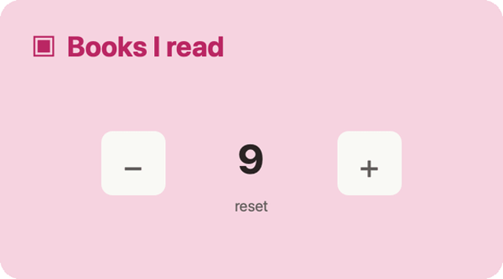

自制 · 可用 · 建议 600 × 333 px

生活计划的组件状态演示。

[打开组件或素材](https://zhangleiye68-jpg.github.io/buildin-reference-widgets/assets/animations/my-life-planner/books-counter-demo.gif) · [原始来源](https://github.com/zhangleiye68-jpg/buildin-reference-widgets/blob/main/docs/assets/animations/my-life-planner/books-counter-demo.gif) · [源码](https://github.com/zhangleiye68-jpg/buildin-reference-widgets/blob/main/docs/assets/animations/my-life-planner/books-counter-demo.gif)

嵌入／素材地址：

```text
https://zhangleiye68-jpg.github.io/buildin-reference-widgets/assets/animations/my-life-planner/books-counter-demo.gif
```

- 600 × 333 px，约 3 秒，36 帧。
- 目录为静帧预览；打开素材地址可查看完整动态效果。
- 这是此前组件审核包的状态演示图片；需要点击、计时或保存计数时，请使用目录中的对应交互组件。
- 计数和时间均为演示状态，不读取或同步个人数据。
- GIF 已设为无限循环。

许可：此前自制模板生成／制作素材，可在本库模板中复用；未声明通用开源许可

目录 ID：`my-life-planner-books-counter-demo-gif`

### 像素植物摆动 GIF · 通用


自制 · 可用 · 建议 520 × 380 px

生活计划的动态装饰素材。

[打开组件或素材](https://zhangleiye68-jpg.github.io/buildin-reference-widgets/assets/animations/my-life-planner/pixel-plant-loop.gif) · [原始来源](https://github.com/zhangleiye68-jpg/buildin-reference-widgets/blob/main/docs/assets/animations/my-life-planner/pixel-plant-loop.gif) · [源码](https://github.com/zhangleiye68-jpg/buildin-reference-widgets/blob/main/docs/assets/animations/my-life-planner/pixel-plant-loop.gif)

嵌入／素材地址：

```text
https://zhangleiye68-jpg.github.io/buildin-reference-widgets/assets/animations/my-life-planner/pixel-plant-loop.gif
```

- 520 × 380 px，约 4 秒，48 帧。
- 目录为静帧预览；打开素材地址可查看完整动态效果。
- 可作为图片、装饰块或原生页面封面使用；按原始比例放置。
- GIF 已设为无限循环。

许可：此前自制模板生成／制作素材，可在本库模板中复用；未声明通用开源许可

目录 ID：`my-life-planner-pixel-plant-loop-gif`

### 房间四景轮播 GIF · 英语演示

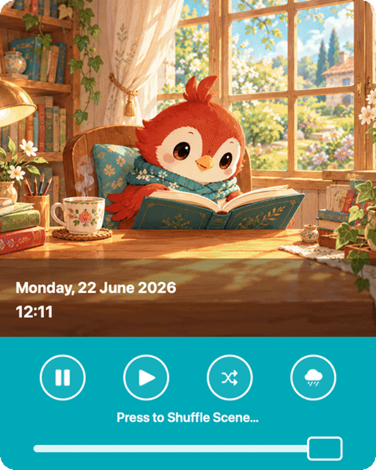

自制 · 可用 · 建议 480 × 600 px

生活计划的动态装饰素材。

[打开组件或素材](https://zhangleiye68-jpg.github.io/buildin-reference-widgets/assets/animations/my-life-planner/room-scene-cycle.gif) · [原始来源](https://github.com/zhangleiye68-jpg/buildin-reference-widgets/blob/main/docs/assets/animations/my-life-planner/room-scene-cycle.gif) · [源码](https://github.com/zhangleiye68-jpg/buildin-reference-widgets/blob/main/docs/assets/animations/my-life-planner/room-scene-cycle.gif)

嵌入／素材地址：

```text
https://zhangleiye68-jpg.github.io/buildin-reference-widgets/assets/animations/my-life-planner/room-scene-cycle.gif
```

- 480 × 600 px，约 9.33 秒，112 帧。
- 目录为静帧预览；打开素材地址可查看完整动态效果。
- 可作为图片、装饰块或原生页面封面使用；按原始比例放置。
- GIF 已设为无限循环。

许可：此前自制模板生成／制作素材，可在本库模板中复用；未声明通用开源许可

目录 ID：`my-life-planner-room-scene-cycle-gif`

### 生活计划花园封面 MP4（原生版） · 通用


自制 · 可用 · 建议 1280 × 320 px

生活计划的动态装饰素材。

[打开组件或素材](https://zhangleiye68-jpg.github.io/buildin-reference-widgets/assets/animations/my-life-planner/cover-garden-loop.mp4) · [原始来源](https://github.com/zhangleiye68-jpg/buildin-reference-widgets/blob/main/docs/assets/animations/my-life-planner/cover-garden-loop.mp4) · [源码](https://github.com/zhangleiye68-jpg/buildin-reference-widgets/blob/main/docs/assets/animations/my-life-planner/cover-garden-loop.mp4)

嵌入／素材地址：

```text
https://zhangleiye68-jpg.github.io/buildin-reference-widgets/assets/animations/my-life-planner/cover-garden-loop.mp4
```

- 1280 × 320 px，约 5 秒，60 帧。
- 目录为静帧预览；打开素材地址可查看完整动态效果。
- MP4 使用视频播放器嵌入；循环与静音由播放器控制。

许可：此前自制模板生成／制作素材，可在本库模板中复用；未声明通用开源许可

目录 ID：`my-life-planner-cover-garden-loop-mp4`

### 房间四景轮播 MP4 · 英语演示

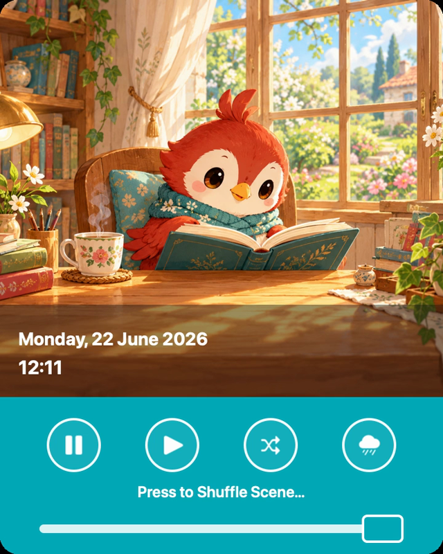

自制 · 可用 · 建议 720 × 900 px

生活计划的动态装饰素材。

[打开组件或素材](https://zhangleiye68-jpg.github.io/buildin-reference-widgets/assets/animations/my-life-planner/room-scene-cycle.mp4) · [原始来源](https://github.com/zhangleiye68-jpg/buildin-reference-widgets/blob/main/docs/assets/animations/my-life-planner/room-scene-cycle.mp4) · [源码](https://github.com/zhangleiye68-jpg/buildin-reference-widgets/blob/main/docs/assets/animations/my-life-planner/room-scene-cycle.mp4)

嵌入／素材地址：

```text
https://zhangleiye68-jpg.github.io/buildin-reference-widgets/assets/animations/my-life-planner/room-scene-cycle.mp4
```

- 720 × 900 px，约 9.33333 秒，112 帧。
- 目录为静帧预览；打开素材地址可查看完整动态效果。
- MP4 使用视频播放器嵌入；循环与静音由播放器控制。

许可：此前自制模板生成／制作素材，可在本库模板中复用；未声明通用开源许可

目录 ID：`my-life-planner-room-scene-cycle-mp4`

