# Buildin 统一组件库

更新：2026-11-03 · 49 个组件 · 11 项素材

[打开可搜索的图文目录](https://zhangleiye68-jpg.github.io/buildin-reference-widgets/catalog/) · [读取完整 JSON](components.json)

以后添加模板，先从本库选择；没有合适的，再寻找新的公开来源，并把新选中的组件补充回来。自制组件使用 GitHub Pages 固定地址。

预览均为组件默认状态，使用说明包含语言、尺寸、参数、来源、许可、外部依赖和已知限制。已失效链接保留作参考，不用于新模板。

## 日期与时钟

### LIFE SPACE 翻页时钟 · 俄语

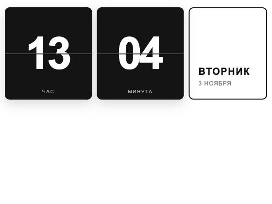

自制 · 可用 · 建议 560 × 420 px

LIFE SPACE 翻页时钟

[打开组件或素材](https://zhangleiye68-jpg.github.io/buildin-reference-widgets/?view=flipclock&lang=ru&v=efe15cc) · [原始来源](https://github.com/zhangleiye68-jpg/buildin-reference-widgets/blob/main/docs/widget.js) · [源码](https://github.com/zhangleiye68-jpg/buildin-reference-widgets/blob/main/docs/widget.js)

嵌入／素材地址：

```text
https://zhangleiye68-jpg.github.io/buildin-reference-widgets/?view=flipclock&lang=ru&v=efe15cc
```

- 独立网页组件，不自动关联 Buildin 原生数据库。

许可：自制，可在本库复用

目录 ID：`widget-001`

### LIFE SPACE 翻页时钟 · 英语／通用

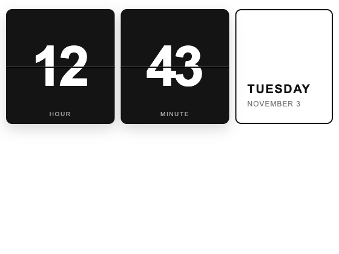

自制 · 可用 · 建议 560 × 420 px

LIFE SPACE 翻页时钟

[打开组件或素材](https://zhangleiye68-jpg.github.io/buildin-reference-widgets/?view=flipclock&v=30d8053) · [原始来源](https://github.com/zhangleiye68-jpg/buildin-reference-widgets/blob/main/docs/widget.js) · [源码](https://github.com/zhangleiye68-jpg/buildin-reference-widgets/blob/main/docs/widget.js)

嵌入／素材地址：

```text
https://zhangleiye68-jpg.github.io/buildin-reference-widgets/?view=flipclock&v=30d8053
```

- 独立网页组件，不自动关联 Buildin 原生数据库。

许可：自制，可在本库复用

目录 ID：`widget-002`

### 商务风格时钟 · 英语／通用

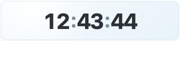

自制 · 可用 · 建议 360 × 140 px

商务风格时钟

[打开组件或素材](https://zhangleiye68-jpg.github.io/buildin-reference-widgets/business-clock.html?v=0c7eb29) · [原始来源](https://github.com/zhangleiye68-jpg/buildin-reference-widgets/blob/main/docs/business-clock.html) · [源码](https://github.com/zhangleiye68-jpg/buildin-reference-widgets/blob/main/docs/business-clock.html)

嵌入／素材地址：

```text
https://zhangleiye68-jpg.github.io/buildin-reference-widgets/business-clock.html?v=0c7eb29
```

- 独立网页组件，不自动关联 Buildin 原生数据库。

许可：自制，可在本库复用

目录 ID：`widget-003`

### 地中海风格时钟 · 俄语（来源模板）

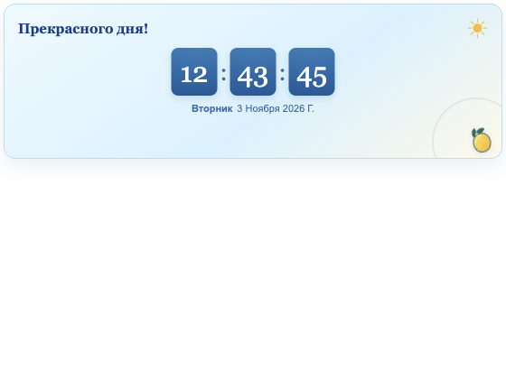

自制 · 可用 · 建议 560 × 420 px

地中海风格时钟

[打开组件或素材](https://zhangleiye68-jpg.github.io/buildin-reference-widgets/?view=med-clock&v=9b2067d) · [原始来源](https://github.com/zhangleiye68-jpg/buildin-reference-widgets/blob/main/docs/widget.js) · [源码](https://github.com/zhangleiye68-jpg/buildin-reference-widgets/blob/main/docs/widget.js)

嵌入／素材地址：

```text
https://zhangleiye68-jpg.github.io/buildin-reference-widgets/?view=med-clock&v=9b2067d
```

- 独立网页组件，不自动关联 Buildin 原生数据库。

许可：自制，可在本库复用

目录 ID：`widget-004`

### 学习计划日期卡片 · 俄语

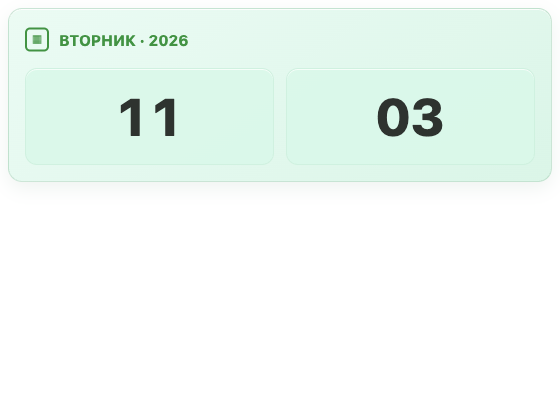

自制 · 可用 · 建议 560 × 420 px

学习计划日期卡片

[打开组件或素材](https://zhangleiye68-jpg.github.io/buildin-reference-widgets/school-planner/date.html?view=date&v=9&locale=ru) · [原始来源](https://github.com/zhangleiye68-jpg/buildin-reference-widgets/blob/main/docs/school-planner/date.html) · [源码](https://github.com/zhangleiye68-jpg/buildin-reference-widgets/blob/main/docs/school-planner/date.html)

嵌入／素材地址：

```text
https://zhangleiye68-jpg.github.io/buildin-reference-widgets/school-planner/date.html?view=date&v=9&locale=ru
```

- 独立网页组件，不自动关联 Buildin 原生数据库。

许可：自制，可在本库复用

目录 ID：`widget-005`

### 学习计划日期卡片 · 英语／通用

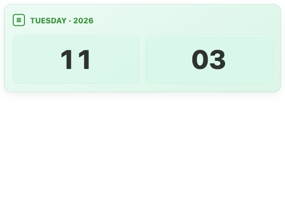

自制 · 可用 · 建议 560 × 420 px

学习计划日期卡片

[打开组件或素材](https://zhangleiye68-jpg.github.io/buildin-reference-widgets/school-planner/date.html?view=date&v=8) · [原始来源](https://github.com/zhangleiye68-jpg/buildin-reference-widgets/blob/main/docs/school-planner/date.html) · [源码](https://github.com/zhangleiye68-jpg/buildin-reference-widgets/blob/main/docs/school-planner/date.html)

嵌入／素材地址：

```text
https://zhangleiye68-jpg.github.io/buildin-reference-widgets/school-planner/date.html?view=date&v=8
```

- 独立网页组件，不自动关联 Buildin 原生数据库。

许可：自制，可在本库复用

目录 ID：`widget-006`

### 深色翻页时钟 · 俄语

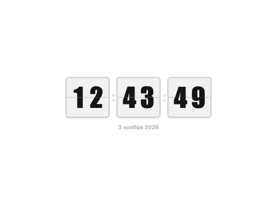

自制 · 可用 · 建议 560 × 420 px

深色翻页时钟

[打开组件或素材](https://zhangleiye68-jpg.github.io/buildin-reference-widgets/school-planner/flip-clock/?locale=ru&v=27) · [原始来源](https://github.com/zhangleiye68-jpg/buildin-reference-widgets/tree/main/docs/school-planner/flip-clock/) · [源码](https://github.com/zhangleiye68-jpg/buildin-reference-widgets/tree/main/docs/school-planner/flip-clock/)

嵌入／素材地址：

```text
https://zhangleiye68-jpg.github.io/buildin-reference-widgets/school-planner/flip-clock/?locale=ru&v=27
```

- 独立网页组件，不自动关联 Buildin 原生数据库。

许可：自制，可在本库复用

目录 ID：`widget-007`

### 生活计划·翻页时钟 · 俄语

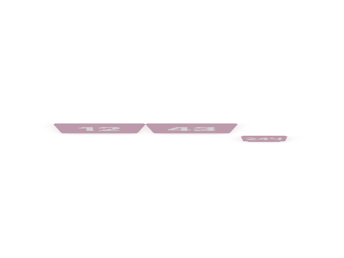

自制 · 可用 · 建议 560 × 420 px

生活计划·翻页时钟

[打开组件或素材](https://zhangleiye68-jpg.github.io/buildin-reference-widgets/my-life-planner/clock.html) · [原始来源](https://github.com/zhangleiye68-jpg/buildin-reference-widgets/blob/main/docs/my-life-planner/clock.html) · [源码](https://github.com/zhangleiye68-jpg/buildin-reference-widgets/blob/main/docs/my-life-planner/clock.html)

嵌入／素材地址：

```text
https://zhangleiye68-jpg.github.io/buildin-reference-widgets/my-life-planner/clock.html
```

- 独立网页组件，不自动关联 Buildin 原生数据库。

许可：自制，可在本库复用

目录 ID：`widget-008`

### 绿色翻页时钟 · 俄语

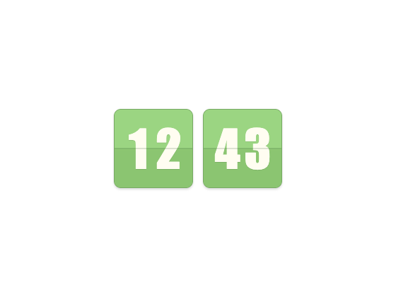

自制 · 可用 · 建议 560 × 420 px

绿色翻页时钟

[打开组件或素材](https://zhangleiye68-jpg.github.io/buildin-reference-widgets/school-planner/green-flip-clock/?locale=ru&v=37) · [原始来源](https://github.com/zhangleiye68-jpg/buildin-reference-widgets/tree/main/docs/school-planner/green-flip-clock/) · [源码](https://github.com/zhangleiye68-jpg/buildin-reference-widgets/tree/main/docs/school-planner/green-flip-clock/)

嵌入／素材地址：

```text
https://zhangleiye68-jpg.github.io/buildin-reference-widgets/school-planner/green-flip-clock/?locale=ru&v=37
```

- 独立网页组件，不自动关联 Buildin 原生数据库。

许可：自制，可在本库复用

目录 ID：`widget-009`

### Cozy 蓝色指针时钟 · 俄语／英语

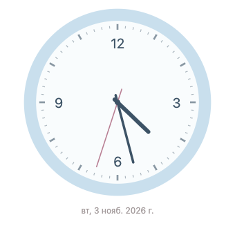

自制 · 可用 · 建议 340 × 340 px

按设备时间更新的蓝色圆形指针时钟。

[打开组件或素材](https://zhangleiye68-jpg.github.io/buildin-reference-widgets/cozy-study/?widget=clock&lang=ru) · [原始来源](https://github.com/zhangleiye68-jpg/buildin-reference-widgets/tree/main/docs/cozy-study/) · [源码](https://github.com/zhangleiye68-jpg/buildin-reference-widgets/tree/main/docs/cozy-study/)

嵌入／素材地址：

```text
https://zhangleiye68-jpg.github.io/buildin-reference-widgets/cozy-study/?widget=clock&lang=ru
```

- 按查看者设备日期与时区显示；可加 theme=light 或 theme=dark。
- 俄语地址：https://zhangleiye68-jpg.github.io/buildin-reference-widgets/cozy-study/?widget=clock&lang=ru
- 目录默认提供俄语地址与真实预览；去掉 lang=ru 可恢复英语。

许可：MIT · [许可与归属](https://github.com/zhangleiye68-jpg/buildin-reference-widgets/blob/main/docs/cozy-study/LICENSE)

目录 ID：`cozy-clock`

### WidgetBox 旧指针时钟参考 · 通用

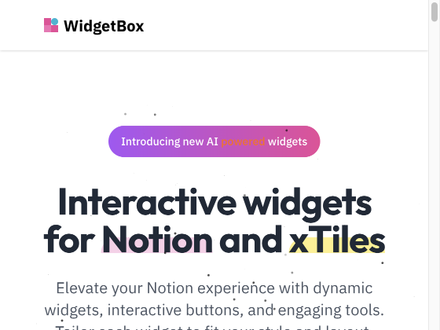

第三方引用 · 已停用参考 · 建议 560 × 420 px

WidgetBox 旧指针时钟参考

[打开组件或素材](https://widgetbox.app/embed/clock/analog/e78606f2-863a-4335-a0b4-5320b334e14e) · [原始来源](https://widgetbox.app/embed/clock/analog/e78606f2-863a-4335-a0b4-5320b334e14e)

嵌入／素材地址：

```text
https://widgetbox.app/embed/clock/analog/e78606f2-863a-4335-a0b4-5320b334e14e
```

- 原模板的旧链接已返回站点推广页，保留作溯源，勿用于新模板。
- 预览若显示站点首页，代表失效状态，不代表原组件效果。

许可：第三方服务，保存引用

目录 ID：`widgetbox-clock-retired`

## 日历

### 地中海风格月历 · 俄语（来源模板）

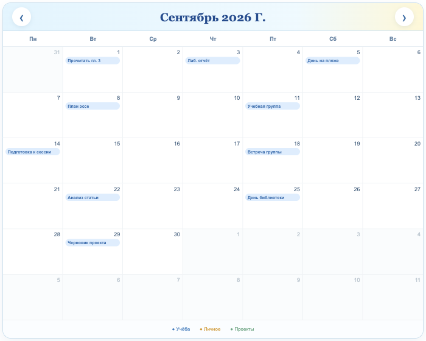

自制 · 含示例内容 · 建议 700 × 560 px

地中海风格月历

[打开组件或素材](https://zhangleiye68-jpg.github.io/buildin-reference-widgets/?view=med-calendar&v=26810d7) · [原始来源](https://github.com/zhangleiye68-jpg/buildin-reference-widgets/blob/main/docs/widget.js) · [源码](https://github.com/zhangleiye68-jpg/buildin-reference-widgets/blob/main/docs/widget.js)

嵌入／素材地址：

```text
https://zhangleiye68-jpg.github.io/buildin-reference-widgets/?view=med-calendar&v=26810d7
```

- 独立网页组件，不自动关联 Buildin 原生数据库。
- 默认打开 2026 年 9 月，可手动切月；包含示例事件，不同步 Buildin 日程。

许可：自制，可在本库复用

目录 ID：`widget-010`

### 简洁月历 · 通用

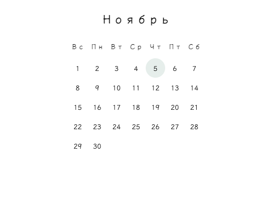

社区源码 · 可用 · 建议 560 × 420 px

简洁月历

[打开组件或素材](https://zhangleiye68-jpg.github.io/buildin-reference-widgets/community/httishere-calendar/calendar.html?sw=1&dd=0) · [原始来源](https://github.com/httIsHere/notion-widget) · [源码](https://github.com/zhangleiye68-jpg/buildin-reference-widgets/tree/main/docs/community/httishere-calendar/)

嵌入／素材地址：

```text
https://zhangleiye68-jpg.github.io/buildin-reference-widgets/community/httishere-calendar/calendar.html?sw=1&dd=0
```

- 社区源码已收录并保留归属、许可；使用本地简化运行脚本。
- 固定 280px 宽，当前月展示，无切月按钮；sw=1 周日起始，省略则周一起始；dd=1 深色。
- 不支持上游加密配置参数。

许可：Apache-2.0；字体 SIL OFL · [许可与归属](https://github.com/zhangleiye68-jpg/buildin-reference-widgets/blob/main/docs/community/httishere-calendar/NOTICE.md)

目录 ID：`widget-011`

### Cozy 动态月历 · 俄语／英语

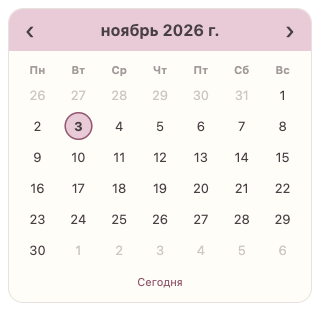

自制 · 可用 · 建议 320 × 320 px

跟随当前月份，高亮今天，可切月、选日期和返回今天。

[打开组件或素材](https://zhangleiye68-jpg.github.io/buildin-reference-widgets/cozy-study/?widget=calendar&lang=ru) · [原始来源](https://github.com/zhangleiye68-jpg/buildin-reference-widgets/tree/main/docs/cozy-study/) · [源码](https://github.com/zhangleiye68-jpg/buildin-reference-widgets/tree/main/docs/cozy-study/)

嵌入／素材地址：

```text
https://zhangleiye68-jpg.github.io/buildin-reference-widgets/cozy-study/?widget=calendar&lang=ru
```

- 周一开始；不存储日程，不连接数据库。
- 可加 theme=light 或 theme=dark；无参数时跟随色彩模式。
- 俄语地址：https://zhangleiye68-jpg.github.io/buildin-reference-widgets/cozy-study/?widget=calendar&lang=ru
- 目录默认提供俄语地址与真实预览；去掉 lang=ru 可恢复英语。

许可：MIT · [许可与归属](https://github.com/zhangleiye68-jpg/buildin-reference-widgets/blob/main/docs/cozy-study/LICENSE)

目录 ID：`cozy-calendar`

### WidgetBox 旧月历参考 · 通用

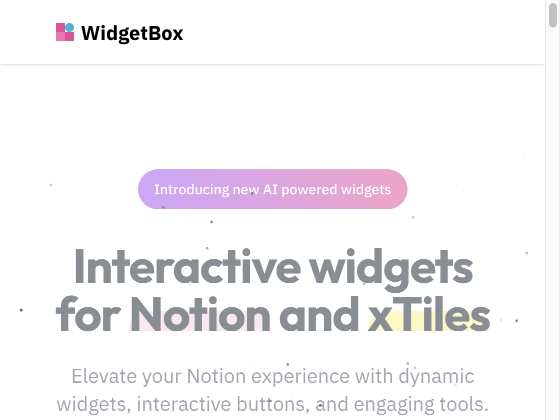

第三方引用 · 已停用参考 · 建议 560 × 420 px

WidgetBox 旧月历参考

[打开组件或素材](https://widgetbox.app/embed/calendar/simple/60788344-032d-4bad-b871-5832168828ae) · [原始来源](https://widgetbox.app/embed/calendar/simple/60788344-032d-4bad-b871-5832168828ae)

嵌入／素材地址：

```text
https://widgetbox.app/embed/calendar/simple/60788344-032d-4bad-b871-5832168828ae
```

- 原模板的旧链接已返回站点推广页，保留作溯源，勿用于新模板。
- 预览若显示站点首页，代表失效状态，不代表原组件效果。

许可：第三方服务，保存引用

目录 ID：`widgetbox-calendar-retired`

## 天气

### 深色天气 · 俄语

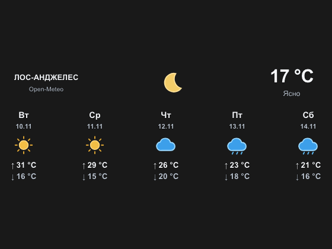

自制 · 可用 · 建议 560 × 420 px

洛杉矶天气与五日预报；保留原深色配置。

[打开组件或素材](https://zhangleiye68-jpg.github.io/buildin-reference-widgets/school-planner/weather/?locale=ru&theme=dark&v=30) · [原始来源](https://github.com/zhangleiye68-jpg/buildin-reference-widgets/tree/main/docs/school-planner/weather/) · [源码](https://github.com/zhangleiye68-jpg/buildin-reference-widgets/tree/main/docs/school-planner/weather/)

嵌入／素材地址：

```text
https://zhangleiye68-jpg.github.io/buildin-reference-widgets/school-planner/weather/?locale=ru&theme=dark&v=30
```

- 独立网页组件，不自动关联 Buildin 原生数据库。
- 浅色文字与透明背景，适合深色模板；浅色页面需提供深色底色。
- 当前固定洛杉矶；变更城市需调整源码配置。

许可：自制，可在本库复用

目录 ID：`widget-012`

## 专注与计时

### 总览计时器 · 俄语


自制 · 可用 · 建议 560 × 420 px

总览计时器

[打开组件或素材](https://zhangleiye68-jpg.github.io/buildin-reference-widgets/?view=timer&lang=ru&dashboard=1) · [原始来源](https://github.com/zhangleiye68-jpg/buildin-reference-widgets/blob/main/docs/widget.js) · [源码](https://github.com/zhangleiye68-jpg/buildin-reference-widgets/blob/main/docs/widget.js)

嵌入／素材地址：

```text
https://zhangleiye68-jpg.github.io/buildin-reference-widgets/?view=timer&lang=ru&dashboard=1
```

- 独立网页组件，不自动关联 Buildin 原生数据库。

许可：自制，可在本库复用

目录 ID：`widget-013`

### 番茄钟·25 分钟工作／5 分钟休息 · 英语／通用

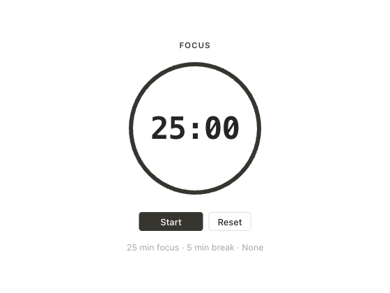

第三方引用 · 可用 · 建议 560 × 420 px

番茄钟·25 分钟工作／5 分钟休息

[打开组件或素材](https://widget0.com/e/pomodoro/?work=25&break=5&sound=None&autostart=false&theme=light&accent=37352f) · [原始来源](https://widget0.com/widgets/pomodoro/)

嵌入／素材地址：

```text
https://widget0.com/e/pomodoro/?work=25&break=5&sound=None&autostart=false&theme=light&accent=37352f
```

- 公开服务组件；未确认源码再分发许可，保存地址及参考图。

许可：第三方服务，保存引用

目录 ID：`widget-014`

### 花园专注计时器 · 俄语

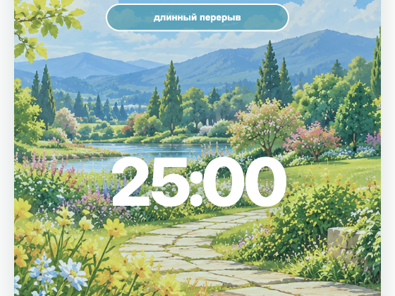

自制 · 可用 · 建议 560 × 420 px

花园专注计时器

[打开组件或素材](https://zhangleiye68-jpg.github.io/buildin-reference-widgets/my-life-planner/pomodoro.html) · [原始来源](https://github.com/zhangleiye68-jpg/buildin-reference-widgets/blob/main/docs/my-life-planner/pomodoro.html) · [源码](https://github.com/zhangleiye68-jpg/buildin-reference-widgets/blob/main/docs/my-life-planner/pomodoro.html)

嵌入／素材地址：

```text
https://zhangleiye68-jpg.github.io/buildin-reference-widgets/my-life-planner/pomodoro.html
```

- 独立网页组件，不自动关联 Buildin 原生数据库。

许可：自制，可在本库复用

目录 ID：`widget-015`

### 计时器 · 俄语

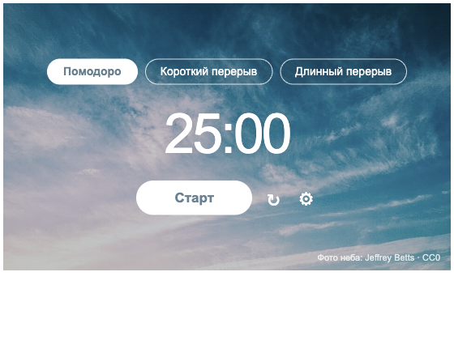

自制 · 可用 · 建议 560 × 420 px

计时器

[打开组件或素材](https://zhangleiye68-jpg.github.io/buildin-reference-widgets/?view=timer&lang=ru&v=ee286ab) · [原始来源](https://github.com/zhangleiye68-jpg/buildin-reference-widgets/blob/main/docs/widget.js) · [源码](https://github.com/zhangleiye68-jpg/buildin-reference-widgets/blob/main/docs/widget.js)

嵌入／素材地址：

```text
https://zhangleiye68-jpg.github.io/buildin-reference-widgets/?view=timer&lang=ru&v=ee286ab
```

- 独立网页组件，不自动关联 Buildin 原生数据库。

许可：自制，可在本库复用

目录 ID：`widget-016`

### 计时器 · 英语／通用

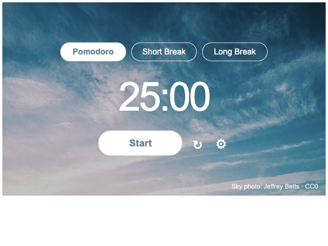

自制 · 可用 · 建议 560 × 420 px

计时器

[打开组件或素材](https://zhangleiye68-jpg.github.io/buildin-reference-widgets/?view=timer) · [原始来源](https://github.com/zhangleiye68-jpg/buildin-reference-widgets/blob/main/docs/widget.js) · [源码](https://github.com/zhangleiye68-jpg/buildin-reference-widgets/blob/main/docs/widget.js)

嵌入／素材地址：

```text
https://zhangleiye68-jpg.github.io/buildin-reference-widgets/?view=timer
```

- 独立网页组件，不自动关联 Buildin 原生数据库。

许可：自制，可在本库复用

目录 ID：`widget-017`

### Study With Me 番茄钟 · 英语

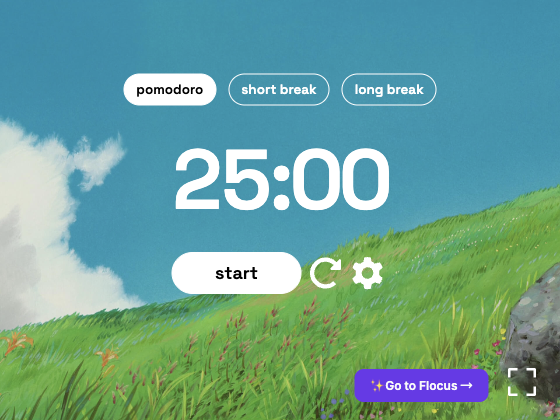

第三方引用 · 可用 · 建议 560 × 420 px

Study With Me 番茄钟

[打开组件或素材](https://studywithme.io/aesthetic-pomodoro-timer/) · [原始来源](https://studywithme.io/)

嵌入／素材地址：

```text
https://studywithme.io/aesthetic-pomodoro-timer/
```

- 公开服务，收录原始入口与参考图；实际可嵌入性以目标平台测试为准。

许可：第三方服务，保存引用

目录 ID：`studywithme-pomodoro`

## 进度

### 地中海风格进度 · 俄语（来源模板）

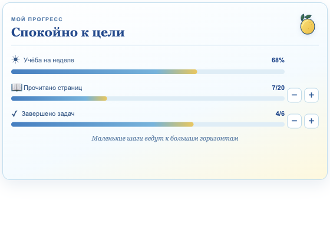

自制 · 可用 · 建议 560 × 420 px

地中海风格进度

[打开组件或素材](https://zhangleiye68-jpg.github.io/buildin-reference-widgets/?view=med-progress&v=9b2067d) · [原始来源](https://github.com/zhangleiye68-jpg/buildin-reference-widgets/blob/main/docs/widget.js) · [源码](https://github.com/zhangleiye68-jpg/buildin-reference-widgets/blob/main/docs/widget.js)

嵌入／素材地址：

```text
https://zhangleiye68-jpg.github.io/buildin-reference-widgets/?view=med-progress&v=9b2067d
```

- 独立网页组件，不自动关联 Buildin 原生数据库。
- 带示例初值，可手动加减；不自动读取数据库完成率。

许可：自制，可在本库复用

目录 ID：`widget-018`

### 总览进度 · 俄语

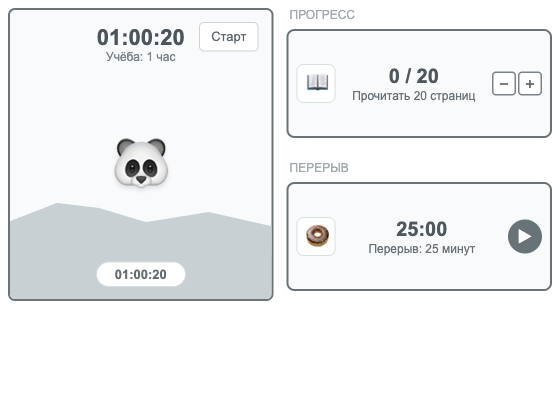

自制 · 可用 · 建议 560 × 420 px

总览进度

[打开组件或素材](https://zhangleiye68-jpg.github.io/buildin-reference-widgets/?view=progress&dashboard=1&lang=ru&v=ee286ab) · [原始来源](https://github.com/zhangleiye68-jpg/buildin-reference-widgets/blob/main/docs/widget.js) · [源码](https://github.com/zhangleiye68-jpg/buildin-reference-widgets/blob/main/docs/widget.js)

嵌入／素材地址：

```text
https://zhangleiye68-jpg.github.io/buildin-reference-widgets/?view=progress&dashboard=1&lang=ru&v=ee286ab
```

- 独立网页组件，不自动关联 Buildin 原生数据库。

许可：自制，可在本库复用

目录 ID：`widget-019`

### 总览进度 · 英语／通用

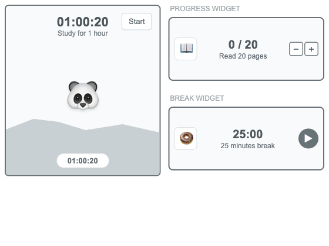

自制 · 可用 · 建议 560 × 420 px

总览进度

[打开组件或素材](https://zhangleiye68-jpg.github.io/buildin-reference-widgets/?view=progress&dashboard=1&v=be7dbb4) · [原始来源](https://github.com/zhangleiye68-jpg/buildin-reference-widgets/blob/main/docs/widget.js) · [源码](https://github.com/zhangleiye68-jpg/buildin-reference-widgets/blob/main/docs/widget.js)

嵌入／素材地址：

```text
https://zhangleiye68-jpg.github.io/buildin-reference-widgets/?view=progress&dashboard=1&v=be7dbb4
```

- 独立网页组件，不自动关联 Buildin 原生数据库。

许可：自制，可在本库复用

目录 ID：`widget-020`

### 时间进度 · 俄语

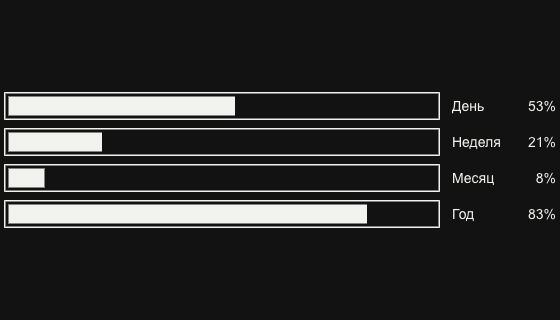

自制 · 可用 · 建议 560 × 320 px

时间进度

[打开组件或素材](https://zhangleiye68-jpg.github.io/buildin-reference-widgets/school-planner/time-progress/?locale=ru&v=31) · [原始来源](https://github.com/zhangleiye68-jpg/buildin-reference-widgets/tree/main/docs/school-planner/time-progress/) · [源码](https://github.com/zhangleiye68-jpg/buildin-reference-widgets/tree/main/docs/school-planner/time-progress/)

嵌入／素材地址：

```text
https://zhangleiye68-jpg.github.io/buildin-reference-widgets/school-planner/time-progress/?locale=ru&v=31
```

- 独立网页组件，不自动关联 Buildin 原生数据库。
- 浅色文字与透明背景，适合深色模板；浅色页面需提供深色底色。

许可：自制，可在本库复用

目录 ID：`widget-021`

### 进度组件 · 俄语

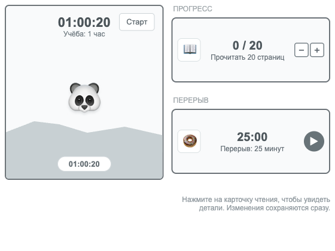

自制 · 可用 · 建议 560 × 420 px

进度组件

[打开组件或素材](https://zhangleiye68-jpg.github.io/buildin-reference-widgets/?view=progress&lang=ru&v=ee286ab) · [原始来源](https://github.com/zhangleiye68-jpg/buildin-reference-widgets/blob/main/docs/widget.js) · [源码](https://github.com/zhangleiye68-jpg/buildin-reference-widgets/blob/main/docs/widget.js)

嵌入／素材地址：

```text
https://zhangleiye68-jpg.github.io/buildin-reference-widgets/?view=progress&lang=ru&v=ee286ab
```

- 独立网页组件，不自动关联 Buildin 原生数据库。

许可：自制，可在本库复用

目录 ID：`widget-022`

### 进度组件 · 英语／通用

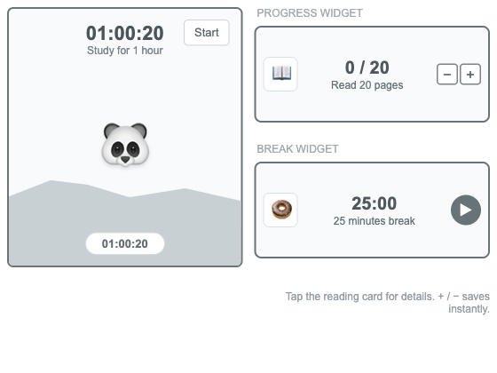

自制 · 可用 · 建议 560 × 420 px

进度组件

[打开组件或素材](https://zhangleiye68-jpg.github.io/buildin-reference-widgets/?view=progress) · [原始来源](https://github.com/zhangleiye68-jpg/buildin-reference-widgets/blob/main/docs/widget.js) · [源码](https://github.com/zhangleiye68-jpg/buildin-reference-widgets/blob/main/docs/widget.js)

嵌入／素材地址：

```text
https://zhangleiye68-jpg.github.io/buildin-reference-widgets/?view=progress
```

- 独立网页组件，不自动关联 Buildin 原生数据库。

许可：自制，可在本库复用

目录 ID：`widget-023`

## 习惯与阅读计数

### 学习计划阅读计数器 · 俄语

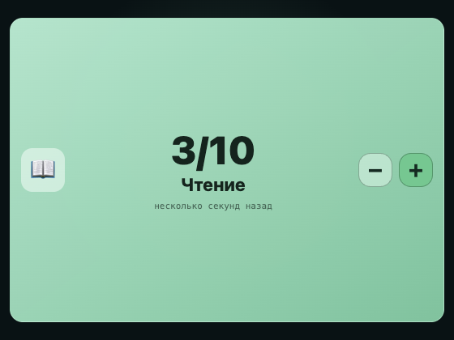

自制 · 可用 · 建议 560 × 420 px

学习计划阅读计数器

[打开组件或素材](https://zhangleiye68-jpg.github.io/buildin-reference-widgets/school-planner/reader.html?view=reader&v=9&locale=ru) · [原始来源](https://github.com/zhangleiye68-jpg/buildin-reference-widgets/blob/main/docs/school-planner/reader.html) · [源码](https://github.com/zhangleiye68-jpg/buildin-reference-widgets/blob/main/docs/school-planner/reader.html)

嵌入／素材地址：

```text
https://zhangleiye68-jpg.github.io/buildin-reference-widgets/school-planner/reader.html?view=reader&v=9&locale=ru
```

- 独立网页组件，不自动关联 Buildin 原生数据库。

许可：自制，可在本库复用

目录 ID：`widget-024`

### 学习计划阅读计数器 · 英语／通用

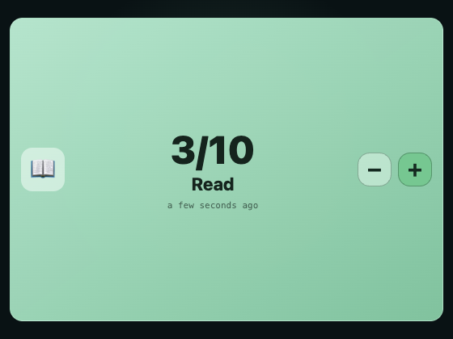

自制 · 可用 · 建议 560 × 420 px

学习计划阅读计数器

[打开组件或素材](https://zhangleiye68-jpg.github.io/buildin-reference-widgets/school-planner/reader.html?view=reader&v=3) · [原始来源](https://github.com/zhangleiye68-jpg/buildin-reference-widgets/blob/main/docs/school-planner/reader.html) · [源码](https://github.com/zhangleiye68-jpg/buildin-reference-widgets/blob/main/docs/school-planner/reader.html)

嵌入／素材地址：

```text
https://zhangleiye68-jpg.github.io/buildin-reference-widgets/school-planner/reader.html?view=reader&v=3
```

- 独立网页组件，不自动关联 Buildin 原生数据库。

许可：自制，可在本库复用

目录 ID：`widget-025`

### 已读书籍计数器 · 俄语

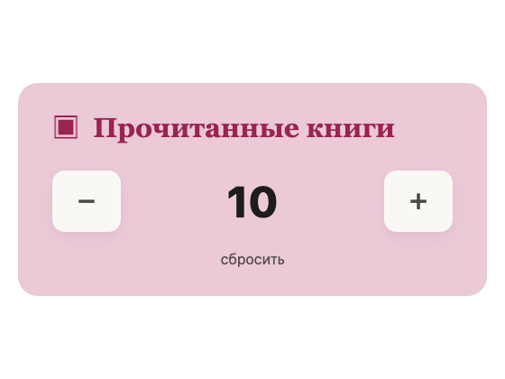

自制 · 可用 · 建议 560 × 420 px

已读书籍计数器

[打开组件或素材](https://zhangleiye68-jpg.github.io/buildin-reference-widgets/my-life-planner/counter.html) · [原始来源](https://github.com/zhangleiye68-jpg/buildin-reference-widgets/blob/main/docs/my-life-planner/counter.html) · [源码](https://github.com/zhangleiye68-jpg/buildin-reference-widgets/blob/main/docs/my-life-planner/counter.html)

嵌入／素材地址：

```text
https://zhangleiye68-jpg.github.io/buildin-reference-widgets/my-life-planner/counter.html
```

- 独立网页组件，不自动关联 Buildin 原生数据库。

许可：自制，可在本库复用

目录 ID：`widget-026`

### 运动目标计数器 · 俄语

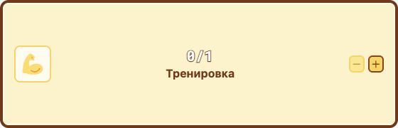

自制 · 可用 · 建议 560 × 180 px

独立目标计数，带加减、进度填充与浏览器本地保存。

[打开组件或素材](https://zhangleiye68-jpg.github.io/buildin-reference-widgets/school-planner/goals/exercise/?locale=ru&v=33) · [原始来源](https://github.com/zhangleiye68-jpg/buildin-reference-widgets/tree/main/docs/school-planner/goals/exercise/) · [源码](https://github.com/zhangleiye68-jpg/buildin-reference-widgets/tree/main/docs/school-planner/goals/exercise/)

嵌入／素材地址：

```text
https://zhangleiye68-jpg.github.io/buildin-reference-widgets/school-planner/goals/exercise/?locale=ru&v=33
```

- 独立网页组件，不自动关联 Buildin 原生数据库。
- 独立本地累计计数，不自动每天清零。

许可：自制，可在本库复用

目录 ID：`widget-027`

### 阅读目标计数器 · 俄语


自制 · 可用 · 建议 560 × 140 px

独立目标计数，带加减、进度填充与浏览器本地保存。

[打开组件或素材](https://zhangleiye68-jpg.github.io/buildin-reference-widgets/school-planner/goals/read/?locale=ru&v=33) · [原始来源](https://github.com/zhangleiye68-jpg/buildin-reference-widgets/tree/main/docs/school-planner/goals/read/) · [源码](https://github.com/zhangleiye68-jpg/buildin-reference-widgets/tree/main/docs/school-planner/goals/read/)

嵌入／素材地址：

```text
https://zhangleiye68-jpg.github.io/buildin-reference-widgets/school-planner/goals/read/?locale=ru&v=33
```

- 独立网页组件，不自动关联 Buildin 原生数据库。
- 独立本地累计计数，不自动每天清零。

许可：自制，可在本库复用

目录 ID：`widget-028`

### 饮水目标计数器 · 俄语

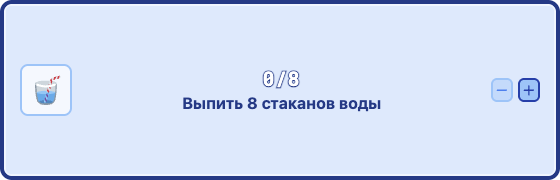

自制 · 可用 · 建议 560 × 180 px

独立目标计数，带加减、进度填充与浏览器本地保存。

[打开组件或素材](https://zhangleiye68-jpg.github.io/buildin-reference-widgets/school-planner/goals/drink/?locale=ru&v=33) · [原始来源](https://github.com/zhangleiye68-jpg/buildin-reference-widgets/tree/main/docs/school-planner/goals/drink/) · [源码](https://github.com/zhangleiye68-jpg/buildin-reference-widgets/tree/main/docs/school-planner/goals/drink/)

嵌入／素材地址：

```text
https://zhangleiye68-jpg.github.io/buildin-reference-widgets/school-planner/goals/drink/?locale=ru&v=33
```

- 独立网页组件，不自动关联 Buildin 原生数据库。
- 独立本地累计计数，不自动每天清零。

许可：自制，可在本库复用

目录 ID：`widget-029`

## 任务与学习面板

### 交互任务面板 · 俄语

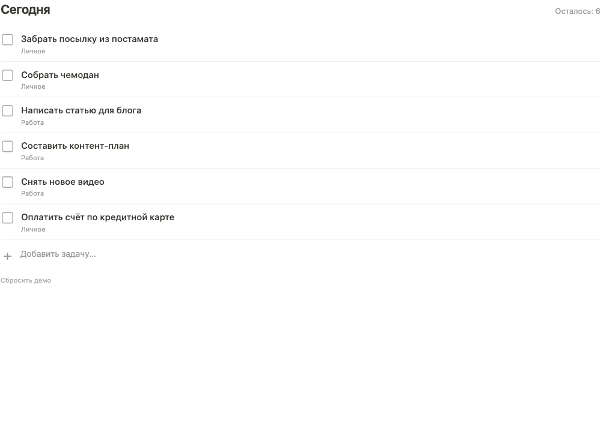

自制 · 可用 · 建议 1000 × 720 px

交互任务面板

[打开组件或素材](https://zhangleiye68-jpg.github.io/task-panel-interaction-demo/?lang=ru&v=f891c3f) · [原始来源](https://github.com/zhangleiye68-jpg/task-panel-interaction-demo) · [源码](https://github.com/zhangleiye68-jpg/task-panel-interaction-demo)

嵌入／素材地址：

```text
https://zhangleiye68-jpg.github.io/task-panel-interaction-demo/?lang=ru&v=f891c3f
```

- 独立网页组件，不自动关联 Buildin 原生数据库。

许可：自制，可在本库复用

目录 ID：`widget-030`

### 交互任务面板 · 英语／通用

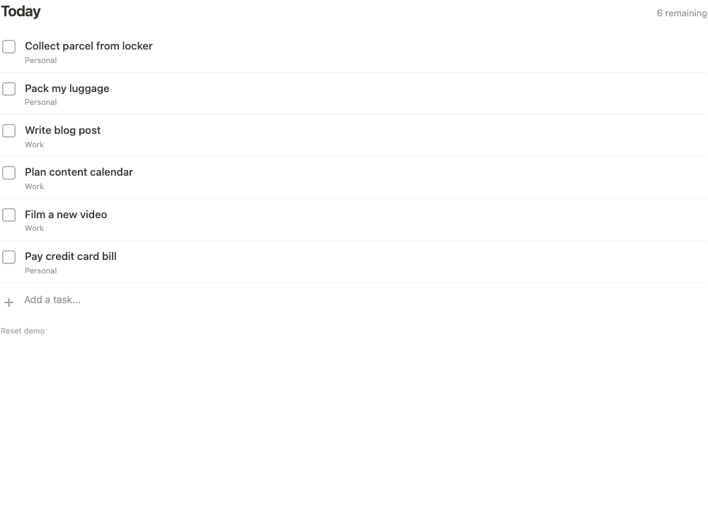

自制 · 可用 · 建议 1000 × 720 px

交互任务面板

[打开组件或素材](https://zhangleiye68-jpg.github.io/task-panel-interaction-demo/) · [原始来源](https://github.com/zhangleiye68-jpg/task-panel-interaction-demo) · [源码](https://github.com/zhangleiye68-jpg/task-panel-interaction-demo)

嵌入／素材地址：

```text
https://zhangleiye68-jpg.github.io/task-panel-interaction-demo/
```

- 独立网页组件，不自动关联 Buildin 原生数据库。

许可：自制，可在本库复用

目录 ID：`widget-031`

### 学习计划网页仪表盘 · 英语／通用

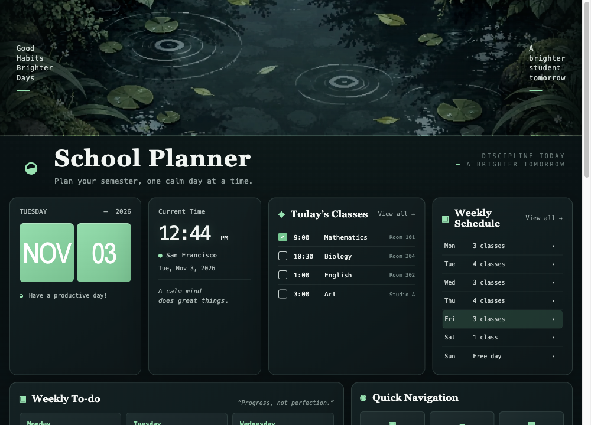

自制 · 可用 · 建议 1000 × 720 px

学习计划网页仪表盘

[打开组件或素材](https://zhangleiye68-jpg.github.io/buildin-reference-widgets/school-planner/dashboard.html?view=dashboard&v=6) · [原始来源](https://github.com/zhangleiye68-jpg/buildin-reference-widgets/blob/main/docs/school-planner/dashboard.html) · [源码](https://github.com/zhangleiye68-jpg/buildin-reference-widgets/blob/main/docs/school-planner/dashboard.html)

嵌入／素材地址：

```text
https://zhangleiye68-jpg.github.io/buildin-reference-widgets/school-planner/dashboard.html?view=dashboard&v=6
```

- 独立网页组件，不自动关联 Buildin 原生数据库。

许可：自制，可在本库复用

目录 ID：`widget-032`

### 学习计划顶部横幅 · 英语／通用


自制 · 可用 · 建议 560 × 420 px

学习计划顶部横幅

[打开组件或素材](https://zhangleiye68-jpg.github.io/buildin-reference-widgets/school-planner/banner.html?view=banner&v=3) · [原始来源](https://github.com/zhangleiye68-jpg/buildin-reference-widgets/blob/main/docs/school-planner/banner.html) · [源码](https://github.com/zhangleiye68-jpg/buildin-reference-widgets/blob/main/docs/school-planner/banner.html)

嵌入／素材地址：

```text
https://zhangleiye68-jpg.github.io/buildin-reference-widgets/school-planner/banner.html?view=banner&v=3
```

- 独立网页组件，不自动关联 Buildin 原生数据库。

许可：自制，可在本库复用

目录 ID：`widget-033`

## 音乐与白噪声

### LIFE SPACE 环境音播放器 · 俄语

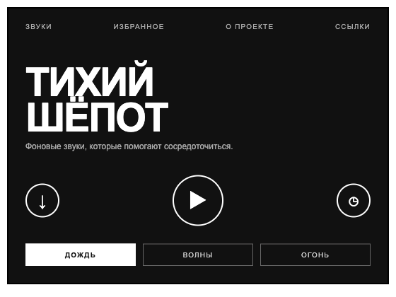

自制 · 可用 · 建议 560 × 420 px

LIFE SPACE 环境音播放器

[打开组件或素材](https://zhangleiye68-jpg.github.io/buildin-reference-widgets/ambient.html?lang=ru&v=37e91a0) · [原始来源](https://github.com/zhangleiye68-jpg/buildin-reference-widgets/blob/main/docs/ambient.html) · [源码](https://github.com/zhangleiye68-jpg/buildin-reference-widgets/blob/main/docs/ambient.html)

嵌入／素材地址：

```text
https://zhangleiye68-jpg.github.io/buildin-reference-widgets/ambient.html?lang=ru&v=37e91a0
```

- 独立网页组件，不自动关联 Buildin 原生数据库。
- 自制合成氛围音示例；不包含第三方歌曲文件。

许可：自制，可在本库复用

目录 ID：`widget-034`

### LIFE SPACE 环境音播放器 · 英语／通用

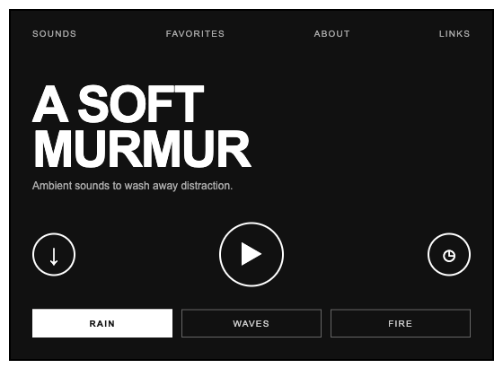

自制 · 可用 · 建议 560 × 420 px

LIFE SPACE 环境音播放器

[打开组件或素材](https://zhangleiye68-jpg.github.io/buildin-reference-widgets/ambient.html?v=09a2036) · [原始来源](https://github.com/zhangleiye68-jpg/buildin-reference-widgets/blob/main/docs/ambient.html) · [源码](https://github.com/zhangleiye68-jpg/buildin-reference-widgets/blob/main/docs/ambient.html)

嵌入／素材地址：

```text
https://zhangleiye68-jpg.github.io/buildin-reference-widgets/ambient.html?v=09a2036
```

- 独立网页组件，不自动关联 Buildin 原生数据库。
- 自制合成氛围音示例；不包含第三方歌曲文件。

许可：自制，可在本库复用

目录 ID：`widget-035`

### Spotify 歌单 · Spotify 界面

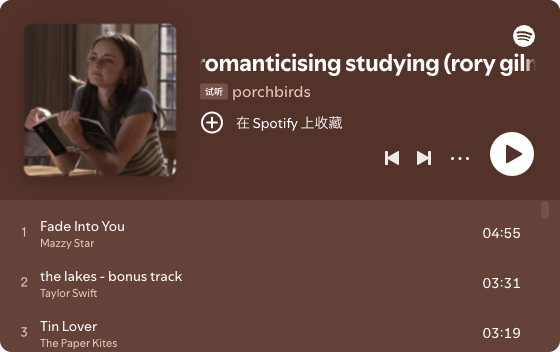

第三方引用 · 可用 · 建议 560 × 352 px

Spotify 歌单

[打开组件或素材](https://open.spotify.com/embed/playlist/5qVEV9KSQzl6MR9qUqFzNW) · [原始来源](https://open.spotify.com/embed/playlist/5qVEV9KSQzl6MR9qUqFzNW)

嵌入／素材地址：

```text
https://open.spotify.com/embed/playlist/5qVEV9KSQzl6MR9qUqFzNW
```

- 仅收录服务嵌入地址与界面参考，不保存音乐文件或服务实现。

许可：第三方服务，保存引用

目录 ID：`widget-036`

### Spotify 歌单·深色 · Spotify 界面

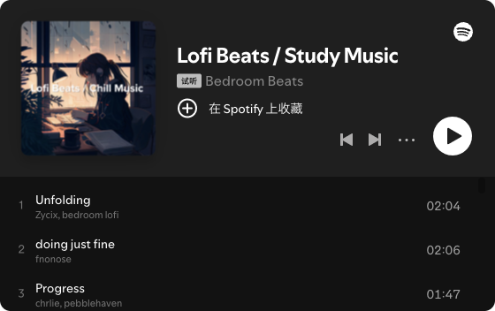

第三方引用 · 可用 · 建议 560 × 352 px

Spotify 歌单·深色

[打开组件或素材](https://open.spotify.com/embed/playlist/2eLwNSlpcwxXHQNWml6m98?theme=0) · [原始来源](https://open.spotify.com/embed/playlist/2eLwNSlpcwxXHQNWml6m98?theme=0)

嵌入／素材地址：

```text
https://open.spotify.com/embed/playlist/2eLwNSlpcwxXHQNWml6m98?theme=0
```

- 仅收录服务嵌入地址与界面参考，不保存音乐文件或服务实现。

许可：第三方服务，保存引用

目录 ID：`widget-037`

### 地中海风格音乐 · 俄语（来源模板）

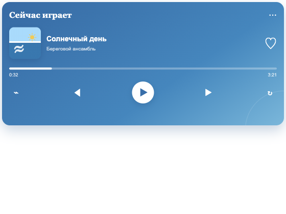

自制 · 可用 · 建议 560 × 420 px

地中海风格音乐

[打开组件或素材](https://zhangleiye68-jpg.github.io/buildin-reference-widgets/?view=med-music&v=9b2067d) · [原始来源](https://github.com/zhangleiye68-jpg/buildin-reference-widgets/blob/main/docs/widget.js) · [源码](https://github.com/zhangleiye68-jpg/buildin-reference-widgets/blob/main/docs/widget.js)

嵌入／素材地址：

```text
https://zhangleiye68-jpg.github.io/buildin-reference-widgets/?view=med-music&v=9b2067d
```

- 独立网页组件，不自动关联 Buildin 原生数据库。
- 自制合成氛围音示例；不包含第三方歌曲文件。

许可：自制，可在本库复用

目录 ID：`widget-038`

### 效率音乐播放器 · 俄语

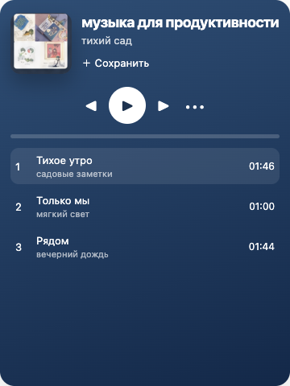

自制 · 可用 · 建议 360 × 480 px

效率音乐播放器

[打开组件或素材](https://zhangleiye68-jpg.github.io/buildin-reference-widgets/my-life-planner/music.html) · [原始来源](https://github.com/zhangleiye68-jpg/buildin-reference-widgets/blob/main/docs/my-life-planner/music.html) · [源码](https://github.com/zhangleiye68-jpg/buildin-reference-widgets/blob/main/docs/my-life-planner/music.html)

嵌入／素材地址：

```text
https://zhangleiye68-jpg.github.io/buildin-reference-widgets/my-life-planner/music.html
```

- 独立网页组件，不自动关联 Buildin 原生数据库。
- 自制合成氛围音示例；不包含第三方歌曲文件。

许可：自制，可在本库复用

目录 ID：`widget-039`

### Spotify 学习歌单 A · Spotify 界面

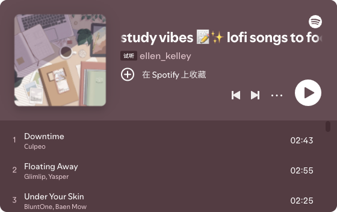

第三方引用 · 可用 · 建议 560 × 352 px

Spotify 学习歌单 A

[打开组件或素材](https://open.spotify.com/embed/playlist/0ofsIXBCxkqYtt30YoJm1c) · [原始来源](https://open.spotify.com/embed/playlist/0ofsIXBCxkqYtt30YoJm1c)

嵌入／素材地址：

```text
https://open.spotify.com/embed/playlist/0ofsIXBCxkqYtt30YoJm1c
```

- 仅保存服务嵌入与预览；播放内容由 Spotify 提供。

许可：第三方服务，保存引用

目录 ID：`spotify-playlist-0ofs`

### Spotify 学习歌单 B · Spotify 界面


第三方引用 · 可用 · 建议 560 × 352 px

Spotify 学习歌单 B

[打开组件或素材](https://open.spotify.com/embed/playlist/6HuGmDDzcvvcJ88nWrPEoG) · [原始来源](https://open.spotify.com/embed/playlist/6HuGmDDzcvvcJ88nWrPEoG)

嵌入／素材地址：

```text
https://open.spotify.com/embed/playlist/6HuGmDDzcvvcJ88nWrPEoG
```

- 仅保存服务嵌入与预览；播放内容由 Spotify 提供。

许可：第三方服务，保存引用

目录 ID：`spotify-playlist-6hug`

## 植物与动物

### 动物·温馨房间 · 俄语


自制 · 可用 · 建议 360 × 480 px

动物·温馨房间

[打开组件或素材](https://zhangleiye68-jpg.github.io/buildin-reference-widgets/my-life-planner/animal.html) · [原始来源](https://github.com/zhangleiye68-jpg/buildin-reference-widgets/blob/main/docs/my-life-planner/animal.html) · [源码](https://github.com/zhangleiye68-jpg/buildin-reference-widgets/blob/main/docs/my-life-planner/animal.html)

嵌入／素材地址：

```text
https://zhangleiye68-jpg.github.io/buildin-reference-widgets/my-life-planner/animal.html
```

- 独立网页组件，不自动关联 Buildin 原生数据库。

许可：自制，可在本库复用

目录 ID：`widget-040`

### 我的植物 · 俄语

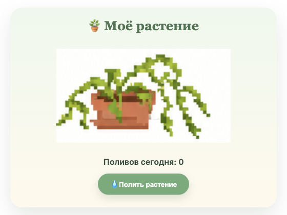

自制 · 可用 · 建议 560 × 420 px

我的植物

[打开组件或素材](https://zhangleiye68-jpg.github.io/buildin-reference-widgets/my-life-planner/plant.html) · [原始来源](https://github.com/zhangleiye68-jpg/buildin-reference-widgets/blob/main/docs/my-life-planner/plant.html) · [源码](https://github.com/zhangleiye68-jpg/buildin-reference-widgets/blob/main/docs/my-life-planner/plant.html)

嵌入／素材地址：

```text
https://zhangleiye68-jpg.github.io/buildin-reference-widgets/my-life-planner/plant.html
```

- 独立网页组件，不自动关联 Buildin 原生数据库。

许可：自制，可在本库复用

目录 ID：`widget-041`

## 封面与装饰

### 花园动态封面 · 俄语


自制 · 可用 · 建议 900 × 420 px

自制花园动态网页封面，可作为独立嵌入组件。

[打开组件或素材](https://zhangleiye68-jpg.github.io/buildin-reference-widgets/my-life-planner/cover.html) · [原始来源](https://github.com/zhangleiye68-jpg/buildin-reference-widgets/blob/main/docs/my-life-planner/cover.html) · [源码](https://github.com/zhangleiye68-jpg/buildin-reference-widgets/blob/main/docs/my-life-planner/cover.html)

嵌入／素材地址：

```text
https://zhangleiye68-jpg.github.io/buildin-reference-widgets/my-life-planner/cover.html
```

- 独立网页组件，不自动关联 Buildin 原生数据库。

许可：自制，可在本库复用

目录 ID：`my-life-garden-cover`

### 地中海柠檬分隔条 · 通用


自制 · 可用 · 建议 560 × 420 px

地中海柠檬分隔条

[打开组件或素材](https://zhangleiye68-jpg.github.io/buildin-reference-widgets/assets/mediterranean/v3/azulejo-lemon-divider-v2.svg?v=99aba43) · [原始来源](https://github.com/zhangleiye68-jpg/buildin-reference-widgets/blob/main/docs/assets/mediterranean/v3/azulejo-lemon-divider-v2.svg) · [源码](https://github.com/zhangleiye68-jpg/buildin-reference-widgets/blob/main/docs/assets/mediterranean/v3/azulejo-lemon-divider-v2.svg)

嵌入／素材地址：

```text
https://zhangleiye68-jpg.github.io/buildin-reference-widgets/assets/mediterranean/v3/azulejo-lemon-divider-v2.svg?v=99aba43
```

- 图片或动图素材，作为图片/原生页面封面使用；不含交互控件。

许可：自制，可在本库复用

目录 ID：`asset-001`

### 日历栏目横幅 · 通用


自制 · 可用 · 建议 560 × 420 px

日历栏目横幅

[打开组件或素材](https://zhangleiye68-jpg.github.io/buildin-reference-widgets/assets/mediterranean/v3/banner-calendar-v3.png?v=9b2067d) · [原始来源](https://github.com/zhangleiye68-jpg/buildin-reference-widgets/blob/main/docs/assets/mediterranean/v3/banner-calendar-v3.png) · [源码](https://github.com/zhangleiye68-jpg/buildin-reference-widgets/blob/main/docs/assets/mediterranean/v3/banner-calendar-v3.png)

嵌入／素材地址：

```text
https://zhangleiye68-jpg.github.io/buildin-reference-widgets/assets/mediterranean/v3/banner-calendar-v3.png?v=9b2067d
```

- 图片或动图素材，作为图片/原生页面封面使用；不含交互控件。

许可：自制，可在本库复用

目录 ID：`asset-002`

### 项目栏目横幅 · 通用


自制 · 可用 · 建议 560 × 420 px

项目栏目横幅

[打开组件或素材](https://zhangleiye68-jpg.github.io/buildin-reference-widgets/assets/mediterranean/v3/banner-projects-v3.png?v=9b2067d) · [原始来源](https://github.com/zhangleiye68-jpg/buildin-reference-widgets/blob/main/docs/assets/mediterranean/v3/banner-projects-v3.png) · [源码](https://github.com/zhangleiye68-jpg/buildin-reference-widgets/blob/main/docs/assets/mediterranean/v3/banner-projects-v3.png)

嵌入／素材地址：

```text
https://zhangleiye68-jpg.github.io/buildin-reference-widgets/assets/mediterranean/v3/banner-projects-v3.png?v=9b2067d
```

- 图片或动图素材，作为图片/原生页面封面使用；不含交互控件。

许可：自制，可在本库复用

目录 ID：`asset-003`

### 课表栏目横幅 · 通用


自制 · 可用 · 建议 560 × 420 px

课表栏目横幅

[打开组件或素材](https://zhangleiye68-jpg.github.io/buildin-reference-widgets/assets/mediterranean/v3/banner-schedule-v3.png?v=9b2067d) · [原始来源](https://github.com/zhangleiye68-jpg/buildin-reference-widgets/blob/main/docs/assets/mediterranean/v3/banner-schedule-v3.png) · [源码](https://github.com/zhangleiye68-jpg/buildin-reference-widgets/blob/main/docs/assets/mediterranean/v3/banner-schedule-v3.png)

嵌入／素材地址：

```text
https://zhangleiye68-jpg.github.io/buildin-reference-widgets/assets/mediterranean/v3/banner-schedule-v3.png?v=9b2067d
```

- 图片或动图素材，作为图片/原生页面封面使用；不含交互控件。

许可：自制，可在本库复用

目录 ID：`asset-004`

### 任务栏目横幅 · 通用


自制 · 可用 · 建议 560 × 420 px

任务栏目横幅

[打开组件或素材](https://zhangleiye68-jpg.github.io/buildin-reference-widgets/assets/mediterranean/v3/banner-tasks-v3.png?v=9b2067d) · [原始来源](https://github.com/zhangleiye68-jpg/buildin-reference-widgets/blob/main/docs/assets/mediterranean/v3/banner-tasks-v3.png) · [源码](https://github.com/zhangleiye68-jpg/buildin-reference-widgets/blob/main/docs/assets/mediterranean/v3/banner-tasks-v3.png)

嵌入／素材地址：

```text
https://zhangleiye68-jpg.github.io/buildin-reference-widgets/assets/mediterranean/v3/banner-tasks-v3.png?v=9b2067d
```

- 图片或动图素材，作为图片/原生页面封面使用；不含交互控件。

许可：自制，可在本库复用

目录 ID：`asset-005`

### 地中海激励装饰图 · 通用


自制 · 可用 · 建议 560 × 420 px

地中海激励装饰图

[打开组件或素材](https://zhangleiye68-jpg.github.io/buildin-reference-widgets/assets/mediterranean/v3/motivation-hd.png?v=9b2067d) · [原始来源](https://github.com/zhangleiye68-jpg/buildin-reference-widgets/blob/main/docs/assets/mediterranean/v3/motivation-hd.png) · [源码](https://github.com/zhangleiye68-jpg/buildin-reference-widgets/blob/main/docs/assets/mediterranean/v3/motivation-hd.png)

嵌入／素材地址：

```text
https://zhangleiye68-jpg.github.io/buildin-reference-widgets/assets/mediterranean/v3/motivation-hd.png?v=9b2067d
```

- 图片或动图素材，作为图片/原生页面封面使用；不含交互控件。

许可：自制，可在本库复用

目录 ID：`asset-006`

### 地中海明信片 · 通用


自制 · 可用 · 建议 560 × 420 px

地中海明信片

[打开组件或素材](https://zhangleiye68-jpg.github.io/buildin-reference-widgets/assets/mediterranean/v3/postcard-hd.png?v=9b2067d) · [原始来源](https://github.com/zhangleiye68-jpg/buildin-reference-widgets/blob/main/docs/assets/mediterranean/v3/postcard-hd.png) · [源码](https://github.com/zhangleiye68-jpg/buildin-reference-widgets/blob/main/docs/assets/mediterranean/v3/postcard-hd.png)

嵌入／素材地址：

```text
https://zhangleiye68-jpg.github.io/buildin-reference-widgets/assets/mediterranean/v3/postcard-hd.png?v=9b2067d
```

- 图片或动图素材，作为图片/原生页面封面使用；不含交互控件。

许可：自制，可在本库复用

目录 ID：`asset-007`

### 地中海个人资料图 · 通用


自制 · 可用 · 建议 560 × 420 px

地中海个人资料图

[打开组件或素材](https://zhangleiye68-jpg.github.io/buildin-reference-widgets/assets/mediterranean/v3/profile-final.png?v=9b2067d) · [原始来源](https://github.com/zhangleiye68-jpg/buildin-reference-widgets/blob/main/docs/assets/mediterranean/v3/profile-final.png) · [源码](https://github.com/zhangleiye68-jpg/buildin-reference-widgets/blob/main/docs/assets/mediterranean/v3/profile-final.png)

嵌入／素材地址：

```text
https://zhangleiye68-jpg.github.io/buildin-reference-widgets/assets/mediterranean/v3/profile-final.png?v=9b2067d
```

- 图片或动图素材，作为图片/原生页面封面使用；不含交互控件。

许可：自制，可在本库复用

目录 ID：`asset-008`

### 花园动态封面 GIF · 通用


自制 · 可用 · 建议 560 × 420 px

花园动态封面 GIF

[打开组件或素材](https://zhangleiye68-jpg.github.io/buildin-reference-widgets/my-life-planner/assets/garden-cover-animated.gif) · [原始来源](https://github.com/zhangleiye68-jpg/buildin-reference-widgets/blob/main/docs/my-life-planner/assets/garden-cover-animated.gif) · [源码](https://github.com/zhangleiye68-jpg/buildin-reference-widgets/blob/main/docs/my-life-planner/assets/garden-cover-animated.gif)

嵌入／素材地址：

```text
https://zhangleiye68-jpg.github.io/buildin-reference-widgets/my-life-planner/assets/garden-cover-animated.gif
```

- 图片或动图素材，作为图片/原生页面封面使用；不含交互控件。

许可：自制，可在本库复用

目录 ID：`asset-009`

### 池塘动态封面 GIF · 通用


自制 · 可用 · 建议 560 × 420 px

池塘动态封面 GIF

[打开组件或素材](https://zhangleiye68-jpg.github.io/buildin-reference-widgets/school-planner/pond-cover.gif) · [原始来源](https://github.com/zhangleiye68-jpg/buildin-reference-widgets/blob/main/docs/school-planner/pond-cover.gif) · [源码](https://github.com/zhangleiye68-jpg/buildin-reference-widgets/blob/main/docs/school-planner/pond-cover.gif)

嵌入／素材地址：

```text
https://zhangleiye68-jpg.github.io/buildin-reference-widgets/school-planner/pond-cover.gif
```

- 图片或动图素材，作为图片/原生页面封面使用；不含交互控件。

许可：自制，可在本库复用

目录 ID：`asset-010`

### 透明封面占位素材 · 通用


自制 · 内部占位 · 建议 560 × 420 px

透明封面占位素材

[打开组件或素材](https://zhangleiye68-jpg.github.io/buildin-reference-widgets/school-planner/transparent-cover-placeholder.svg) · [原始来源](https://github.com/zhangleiye68-jpg/buildin-reference-widgets/blob/main/docs/school-planner/transparent-cover-placeholder.svg) · [源码](https://github.com/zhangleiye68-jpg/buildin-reference-widgets/blob/main/docs/school-planner/transparent-cover-placeholder.svg)

嵌入／素材地址：

```text
https://zhangleiye68-jpg.github.io/buildin-reference-widgets/school-planner/transparent-cover-placeholder.svg
```

- 内部透明占位素材，不作为可见装饰图推荐。

许可：自制，可在本库复用

目录 ID：`asset-011`

